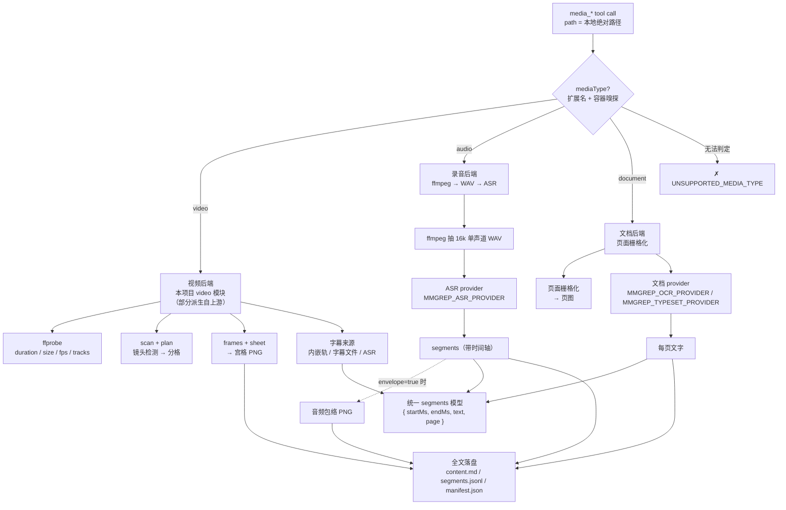

# MultiMediaGrep — MCP 工具契约

> 面向 agent（调用方）与实现者（写 server 的人）的规格文档。**这不是代码**，是双方都要签字的约定。
>
> 状态：设计稿 v1 · 对应 beads `MultiMediaGrep-9z5.4`（工具 MCP 契约）与 `MultiMediaGrep-32x`（图片 token 预算）
>
> 上游参考：[`dsh-video-storyboard`](https://github.com/SAOS-3624/dsh-video-storyboard) v0.5.9（Apache-2.0）。本项目的视频模块部分派生自它，见 `NOTICE` / `CREDITS.md`。

---

## 1. 这份契约是什么

MultiMediaGrep 是一个 **MCP server**：默认走 stdio（由宿主拉起），也可以显式开启 Streamable HTTP（`POST /mcp`）。它给任何 MCP client 的 agent 提供「看 / 听」本地媒体的能力：

| 媒体 | agent 能拿到什么 |
|---|---|
| 视频 | 分镜宫格图（多格拼图，每格编号 + 时间戳）+ 按时间对齐的文本清单 |
| 录音 | 带时间轴的转写文本（可选音频包络图） |
| 文档 | 页面缩略图拼图 + 每页文字（若配置了文档解析服务） |

三条不可动摇的边界：

1. **server 自己绝不调用 LLM。** server 只做「取帧 / 转写 / 排版」，理解由 agent 自己的多模态模型完成。
2. **server 不做取数。** 只收本地文件的绝对路径；拒绝 URL；不碰 cookie、不替你管理凭据、不下载。provider key 只由调用方显式提供（环境变量或 HTTP 请求头）。
3. **server 不保存用户凭据。** stdio 模式不做鉴权；HTTP 模式只做 Bearer 令牌这一层接入控制。请求头里的 provider key 只活在这一个请求内，不落盘、不缓存、不回显。需要字幕就让取数层把字幕文件交给它。

契约里出现的一切**工具名、参数名、字段名、工具描述文本**都是英文（agent 的 API 面）；本文件的**正文说明是中文**。

---

## 2. 全局约定

### 2.1 媒体类型判定与后端分派

`mediaType` 有且只有三个取值：`video` / `audio` / `document`。

判定顺序（先扩展名，后容器嗅探；两者冲突时以容器嗅探为准）：

1. 扩展名落在下表 → 候选类型。
2. 用 `ffprobe`（视频/音频）或文件魔数 + 解析头（文档）确认：
   - 扩展名说是视频，但容器里**没有视频流** → 退化为 `audio`（例如伪装成 `.mp4` 的纯音频）。
   - 扩展名说是视频/音频，但容器里**只有视频流没有音频流** → 仍是 `video`（无声视频合法）。
   - 魔数是 `%PDF` → `document`（不论扩展名）。
3. 判定失败 → 抛 `UNSUPPORTED_MEDIA_TYPE`。

| mediaType | 扩展名（不区分大小写） | 判定依据 |
|---|---|---|
| `video` | `mp4` `mov` `mkv` `webm` `avi` `m4v` `mpg` `mpeg` `ts` `flv` `wmv` `3gp` `ogv` | 容器含视频流 |
| `audio` | `mp3` `wav` `m4a` `aac` `flac` `ogg` `opus` `wma` `aiff` `amr` `m4b` `weba` | 容器含音频流且无视频流 |
| `document` | `pdf` `docx` `doc` `pptx` `ppt` `xlsx` `xls` `epub` `rtf` `odt` `ods` `txt` `md` `csv` `html` `htm` `png` `jpg` `jpeg` `webp` `tiff` `tif` `bmp` `heic` | 魔数 / 文档解析器可打开 |

后端分派（`mediaType` → 具体实现）：

| mediaType | 后端 | 关键组成 |
|---|---|---|
| `video` | **视频后端** | 本项目自己的视频管线（部分模块派生自 `dsh-video-storyboard`）：`probe.js`（ffprobe）、`shots.js`/`storyboard.js`（镜头检测与分格）、`frames.js`/`sheet.js`（取帧与拼图）、`transcript.js`（转写） |
| `audio` | **录音后端** | ffmpeg 抽 16 kHz 单声道 WAV → ASR provider → 带时间轴的 segments；可选音频包络图 |
| `document` | **文档后端** | 页面栅格化（页图）＋ 可选文档解析 provider（每页文字） |



### 2.2 参数适用性总表

**规则：不适用的参数必须报错，不能静默忽略。** 静默忽略会让 agent 以为参数生效了，然后在错误的时间窗里读到错误的内容。

| 参数 | video | audio | document | 不适用时的错误文案（节选） |
|---|:---:|:---:|:---:|---|
| `path` | ✅ 必填 | ✅ 必填 | ✅ 必填 | — |
| `subtitle` | ✅ | ✅ | ❌ | `subtitle is not applicable to document media. Documents have a page text layer, not a transcript.` |
| `transcript` | ✅ | ✅ | ❌ | `transcript is not applicable to document media.` |
| `start`（秒） | ✅ | ✅ | ❌ | `start is not applicable to document media. Use "pages" instead (e.g. pages: "3-10,15").` |
| `end`（秒） | ✅ | ✅ | ❌ | `end is not applicable to document media. Use "pages" instead (e.g. pages: "3-10,15").` |
| `segment`（秒） | ✅ | ✅ | ❌ | `segment is not applicable to document media.` |
| `pages` | ❌ | ❌ | ✅ | `pages is not applicable to video media. Use "start" and "end" (seconds) instead.` |
| `query` | ✅ | ✅ | ✅ | — |
| `max` | ✅ | ✅ | ✅ | — |
| `includeFrame` | ✅ | ❌ | ✅ | `includeFrame is not applicable to audio media. There are no frames to show.` |
| `at`（秒） | ✅ | ❌ | ❌ | `at is not applicable to audio media. media_zoom returns one frame for video and one page image for document; for audio use media_locate to find timestamps.` |
| `crop` | ✅ | ❌ | ✅ | `crop is not applicable to audio media.` |
| `page` | ❌ | ❌ | ✅ | `page is not applicable to video media. media_zoom uses "at" (or "start"/"end") for video.` |
| `cells` | ✅ | ❌ | ✅ | `cells is not applicable to audio media. A recording has no frames; media_overview returns a timestamped transcript instead.` |
| `images` | ✅ | ✅ 仅 `0` | ✅ | `images is not applicable to audio media.` |
| `maxEdge` | ✅ | ❌ | ✅ | `maxEdge is not applicable to audio media.` |
| `envelope` | ❌ | ✅ | ❌ | `envelope is not applicable to video media. It only applies to audio recordings.` |

文档的 `cells` 语义是「每张拼图放几页缩略图」；视频的 `cells` 语义是「每张宫格放几个镜头格」。同一个名字，两种媒体各自解释——这是「按动作命名、跨媒体统一」的核心收益。

**`images: 0` = 零像素纯文本模式。** 三种媒体都认这个值：视频**不扫镜头、不抽帧**（这条路径上一次 ffmpeg 都不跑），录音**不出波形图**（`images: 0` 压过 `envelope: true`），文档**不渲染页图**（只回页文字）。返回的 `budget` 全是零（`requestedImages` / `producedImages` / `estimatedTokens`），全文照常落盘，窗口与续读提示不变。这是「只要文字、不想付画面钱」的入口。

### 2.3 时间与页码表示

**时间一律给两种表示**，缺一不可：

| 形式 | 字段命名 | 类型 | 含义 |
|---|---|---|---|
| 毫秒整数 | `startMs` / `endMs` / `atMs` | integer | 从媒体开头算起的毫秒数，**向下取整到整数毫秒**。JSON 里的权威值。 |
| 秒（浮点） | `startSec` / `endSec` / `atSec` | number | 同一时刻的秒表示，毫秒精度（例：`12.76`）。给人看、给 agent 心算用。 |
| 人类可读标签 | `startLabel` / `endLabel` | string | 文本清单里用的标签，格式 `mm:ss.mmm`；超过一小时用 `hh:mm:ss.mmm`。例：`00:12.760`。 |

页码：`page` 为 **1-based 整数**，闭区间。

**区间语义（收窄范围，写死，不给实现留歧义）**

| 媒体 | 范围参数 | 语义 | 边界 |
|---|---|---|---|
| video / audio | `start` / `end` | **闭区间** `[start, end]`，单位秒（浮点），**两端都含** | `start >= 0`；`end` 必须 `> start`；`end` 可以等于媒体时长 |
| document | `pages` | **闭区间**的逗号列表，如 `"3-10,15"`；每个区间**含首尾两页** | 页码 **1-based**；区间必须从小到大 |

**越界一律报错，绝不静默裁剪**（唯一例外见下表最后一行）：

| 情形 | 行为 |
|---|---|
| `pages` 页码 > 文档总页数 | **报错**，不裁剪 |
| `pages` 页码 < 1 | **报错** |
| `start` >= 媒体时长 | **报错**（窗口内没有任何内容可给） |
| `start` < 0 | **报错** |
| `end` <= `start` | **报错** |
| `end` > 媒体时长 | **裁剪到媒体末尾**，返回值里 `window.clipped = true` + 实际 `endMs` |

`end` 是唯一的例外：超出末尾通常意味着 agent 对素材长度估错，而不是「我要的东西不存在」，裁到末尾仍然交付了它想要的内容。`pages` 与 `start` 不适用这个宽容处理——它们越界说明参数本身写错了，必须让 agent 知道。

### 2.4 错误模型

工具失败时返回标准 MCP 错误结果：

```json
{
  "content": [ { "type": "text", "text": "INVALID_ARGUMENT: pages is invalid: \"abc\". ..." } ],
  "structuredContent": {
    "error": {
      "code": "INVALID_ARGUMENT",
      "message": "pages is invalid: \"abc\". Expected a comma-separated list of page numbers and closed ranges, e.g. \"3-10,15\".",
      "hint": "Use pages: \"3-10,15\"."
    }
  },
  "isError": true
}
```

**错误码全集：**

| code | 何时用 |
|---|---|
| `INVALID_ARGUMENT` | 参数缺失、类型错、取值非法、参数不适用于该媒体类型 |
| `PATH_NOT_FOUND` | 路径不存在 |
| `NOT_A_FILE` | 路径存在但不是普通文件（目录 / 设备 / 管道） |
| `NOT_A_LOCAL_PATH` | 传了 URL 或相对路径 |
| `UNSUPPORTED_MEDIA_TYPE` | 无法判定 mediaType |
| `OUT_OF_RANGE` | `start`/`end`/`pages` 超出媒体实际长度 |
| `NO_TRANSCRIPT` | 需要转写但没有任何可用来源（且不允许降级为纯画面） |
| `PROVIDER_NOT_CONFIGURED` | 需要 ASR / OCR / 文档解析，但对应 provider 未配置 |
| `PROVIDER_FAILED` | provider 已配置但调用失败（HTTP 错误 / 超时 / 坏响应） |
| `TRANSCRIPT_UNREADABLE` | 字幕文件存在但解析不出内容（显式 `subtitle` 统一转成 `INVALID_ARGUMENT`；自动发现路径只记 warning） |
| `BUDGET_EXCEEDED` | 请求超出图片预算硬上限 |
| `TOOL_NOT_FOUND` | `ffmpeg` / `ffprobe` / 页面栅格化器缺失 |
| `INTERNAL` | 其它未分类异常（必须带上原始 stack 摘要） |

**路径校验（每个工具都会跑，顺序固定）：**

1. 缺失 → `INVALID_ARGUMENT: path is required.`
2. 含协议头（匹配 `^[a-zA-Z][a-zA-Z0-9+.\-]*://` 或以 `//` 开头）→
   `NOT_A_LOCAL_PATH: path must be a local absolute file path; URLs are not accepted ("https://example.com/a.mp4"). This server never downloads anything — fetch the file first, then pass its local path.`
   （`file://` 同样拒绝：让 agent 传裸路径，避免 URI 转义歧义。）
3. 不是绝对路径 →
   `INVALID_ARGUMENT: path must be an absolute local path; got "videos/a.mp4". Use an absolute path such as "/abs/path/videos/a.mp4".`
4. 不存在 → `PATH_NOT_FOUND: path does not exist: "/abs/path/a.mp4".`
5. 不是普通文件 → `NOT_A_FILE: path is not a regular file: "/abs/path/a.mp4".`

**范围校验：**

| 情况 | 错误文案 |
|---|---|
| `start < 0` | `start must be >= 0.` |
| `end <= start` | `end must be greater than start (end=10, start=30).` |
| `start` 超出媒体时长 | `start (7200.0 s) is beyond the end of the media (duration 3600.0 s).` |
| `segment` 越界 | `segment must be an integer between 30 and 3600 (seconds).` |
| `pages` 为空串 | `pages must not be empty. Use a comma-separated list of page numbers and closed ranges, e.g. "3-10,15".` |
| `pages` 非法 token | `pages is invalid: "abc". Expected a comma-separated list of page numbers and closed ranges, e.g. "3-10,15".` |
| `pages` 页码 < 1 | `pages is invalid: "0". Page numbers start at 1.` |
| `pages` 区间倒置 | `pages is invalid: "10-3". Ranges must be low-to-high with inclusive bounds, e.g. "3-10".` |
| `pages` 越界 | `pages out of range: 12-15. This document has 8 pages.` |
| `crop` 越界 | `crop must satisfy 0 <= x, 0 <= y, x + width <= 1, y + height <= 1 (got x=0.9, width=0.3).` |

**`pages` 的解析规则（写死，不给实现留歧义）：**

- 语法：逗号分隔的 item 列表；item = `N` 或 `N-M`（闭区间）。
- 允许 item 周围有空白；允许重复；重复与重叠**去重后按升序合并**（`"3-10,15,3"` → `3,4,5,6,7,8,9,10,15`）。
- 不允许负数、小数、空 item（`"3,,5"`）、`M < N`。
- 省略 `pages` = 全文（全页）。
- 越界**报错**，不静默截断（agent 拼错页码时必须知道自己拼错了）。

### 2.5 转写来源与可信度

**每个工具的返回里都带「这段文字 / 这张图是哪来的」。** agent 必须知道自己在读的是字幕文件里的文字、机器猜的转写，还是根本没有文字——这三者的可信度差一个数量级。

`source` 枚举（**可信度口径**）：

| 值 | 含义 | 可信度 | agent 该怎么用 |
|---|---|---|---|
| `subtitle` | 字幕文件或容器内嵌字幕轨里的文字 | 中高 | 通常是作者原话，但**可能是自动生成的**：专有名词、数字要自己核对画面 |
| `ocr` | 从画面 / 页面上 OCR 出来的文字 | 中高 | 可引用，但专有名词、数字要自己核对 |
| `asr` | 语音识别转写 | **最低** | **不可当原话引用**——人名、数字、术语会错 |
| `visual` | 没有文字来源，只有画面 | — | 只能描述画面，不能转述「说了什么」 |
| `none` | 该项为空 | — | — |

`origin` 枚举（**来源渠道口径**）：`file`（外部字幕文件）/ `embedded`（容器内嵌字幕轨）/ `asr` / `ocr` / `none`。

两个字段一起给：`source = "subtitle"` + `origin = "embedded"` = 视频自带的字幕轨；`source = "subtitle"` + `origin = "file"` = 取数层给的字幕文件；`source = "asr"` + `origin = "asr"` = 机器转的。

> **硬约束一：ASR 转写不得被当作原话引用。** ASR 会把人名、数字、专业术语听错——上游 `dsh-video-storyboard` 专门写了一个 OCR 模块来用画面里的硬字幕校正 ASR 文本，理由就是「画面更可信」。所以凡是 `source = "asr"` 的段落，工具描述与 server instructions 都要提醒 agent 标注不确定。

> **硬约束二：字幕不保证是作者原创，更不保证「可安全引用」。** 字幕轨与字幕文件同样可能是机器自动生成的（自动字幕 / 滚动式字幕）：里面的人名、数字、术语同样会错。所以工具描述、server instructions 与 overview 的 note 一律用中性措辞——`subtitle — from a subtitle file/track; usually the author's words, but may be auto-generated: check names and numbers against the frame.`，**不作任何绝对的可引用承诺**。cue 之间大面积时间重叠（> 30%）时，overview 与 locate 还要额外给出警告 `rolling/auto-style captions detected — treat like ASR: check names and numbers against the frame.`。

> **定位指标按媒体类型分两套。** 视频 / 录音的 `media_locate` 报 `score`（0–1，越大越像）；
> 文档的 `media_locate` 报 `hits`（该页命中几次）+ `snippet`（命中附近的片段），**没有 `score`**：
> 文档的 segment 粒度就是整页，同一个字段两种语义会打架。详见 §7.3.1。

### 2.6 长任务与进度通知

| 工具 | `timeoutMs` | 是否发 progress notification |
|---|---|---|
| `media_probe` | 30,000 | 否（毫秒级返回） |
| `media_overview` | 600,000 | 是（扫描 / 转写 / 渲染三阶段各报一次） |
| `media_zoom` | 120,000 | 是 |
| `media_locate` | 180,000 | 是（仅在需要现场跑 ASR 时） |

progress token 形如 `media_overview 3/5 · scanning 0-300s`，让宿主 UI 能显示进度。**进度通知是 best-effort**：宿主不支持 `notifications/progress` 时静默跳过，不影响结果。

### 2.7 缓存与落盘约定

| 约定 | 内容 |
|---|---|
| 缓存**主键** | **源文件内容的 sha256**（`sha256:<64 位 hex>`），不是路径 + 大小 + mtime。内容变了 → key 变了 → 缓存自然失效 |
| **快速指纹索引** | 另有一份 `fingerprint-index.json`：`sha256(绝对路径 + ':' + size + ':' + mtimeMs)` → 内容 sha256。命中指纹就跳过全文件哈希；不命中就老老实实算内容 hash 并写回索引 |
| 缓存目录 | `MMGREP_CACHE_DIR`（默认 `~/.cache/multimediagrep`），**绝不写到用户文件旁边** |
| 容量 | `MMGREP_CACHE_MAX_BYTES`（默认 10 GiB），超出按 LRU 淘汰整条目 |
| provider 逐页结果缓存 | 文档 provider 的结果按页写入同一缓存树：namespace = `sha256:<源内容 hash>:doc-provider:<role>:<hash(源 hash + provider id + model + ocrMode + role)>`，每页存契约 v2 的 page 对象。同一范围再次调用（overview / locate 共享）不再请求 provider，只把缺失页发出去；`ocrMode=force` 单独成键，不覆盖 auto / 文字层结果 |
| 落盘产物 | `content.md` + `segments.jsonl` + `manifest.json`（三个必备）+ `document.json`（可选，cangjie `SourceDocument Contract v1`） |

细节见 §9。

### 2.8 传输方式：stdio 与 HTTP

| | stdio（默认） | Streamable HTTP（显式开启） |
|---|---|---|
| 怎么开 | 不传 `--http`、不设 `MMGREP_TRANSPORT` | `--http` 或 `MMGREP_TRANSPORT=http` |
| 监听 | 不监听端口；宿主用 stdin/stdout 通信 | `POST /mcp`，默认 `127.0.0.1:3927` |
| 鉴权 | 无（进程由宿主拉起，边界是宿主） | 可选 Bearer 令牌；配了令牌后每个请求都要带 `Authorization: Bearer <令牌>` |
| 凭据 | 只读 server 启动时的环境变量 / 配置 | 可用 `x-mmgrep-*` 请求头逐请求覆盖（见 §12.7） |
| 生命周期 | 进程阻塞到 client 关闭 stdin | 无状态：每个请求新建 server + transport，处理完即关 |
| 工具语义 | 完全相同 | 完全相同 |

两边的差异只影响「怎么连、用谁的 key」，不影响任何工具的参数、返回结构、错误码或图片预算。
HTTP 模式下，带了凭据头的请求会用本次请求解析出的配置新建 provider；**凭据不按请求缓存**，
请求结束即丢弃。没带任何凭据头的请求复用启动时的 runtime。

HTTP 端点对 `Accept` / `Content-Type` 有要求：请求必须同时接受 `application/json` 与
`text/event-stream`（否则 406），`Content-Type` 必须是 `application/json`（否则 415）。
端点只接受 `POST /mcp`；其它路径 404，其它方法 405。配了令牌时，缺失或错误的 `Authorization`
返回 401（`WWW-Authenticate: Bearer realm="multimediagrep"`），且鉴权在方法判断之前执行。
请求体上限 1 MiB（超出 413）；单次请求超时 120 s，超时会中止在途工具调用，响应尚未开始时回 504。

> HTTP 模式是 **opt-in**：不显式开启时 server 不监听任何端口，现有的 stdio 接入方式不需要改动。

---

## 3. 工具总览

| 工具 | 动作 | video | audio | document | 出图 |
|---|---|:---:|:---:|:---:|:---:|
| `media_probe` | 探媒体 | ✅ | ✅ | ✅ | 0 张 |
| `media_overview` | 总览 | ✅ | ✅ | ✅ | 0–4 张 |
| `media_zoom` | 特写 | ✅ | ❌ | ✅ | 1 张 |
| `media_locate` | 定位 | ✅ | ✅ | ✅ | 0–1 张 |

**调用顺序建议：`media_probe` → `media_overview` → （必要时）`media_zoom` / `media_locate`。**

**每个工具的返回都带 `source` 字段**（`subtitle` / `ocr` / `asr` / `visual` / `none`）标注内容的来源与可信度，见 §2.5。

---

## 4. `media_probe` — 探媒体

> agent 的第一站。不花图片 token，几毫秒返回「这文件是什么、能怎么读」。

### 4.1 工具描述（英文，含中文触发词）

```
Inspect a local media file — video, audio recording, or document — and report what it is:
duration, resolution, page count, codec, available tracks (audio / subtitle / text layer), and
whether transcription (ASR) and OCR are available for this file.
(读取本地媒体的元信息：时长、分辨率、页数、编码、可用轨道（音轨 / 字幕轨 / 文本层），
以及能否做 ASR / OCR 的初判。)

Call this FIRST on any file you have not inspected yet. It costs no image tokens and decodes
nothing. Then pick the right next tool:
- video / audio  -> media_overview to read it
- document       -> media_overview to see page thumbnails and per-page text
- a specific moment or page -> media_zoom for a close-up
- "where was X said / on which page" -> media_locate for a timestamp or a page number

For audio it also reports a quick health check — average level, speech ratio and silence ratio
— so you know whether the recording actually contains audible speech before you spend an ASR
call on it. A recording that is effectively silent is reported as such and is never sent to ASR
(no hallucinated transcript).

This server never downloads anything and never calls an LLM: you always pass a local absolute
path, and it only prepares images and text for your own model to look at.
```

### 4.2 参数

| 参数 | 类型 | 必填 | 默认 | 说明 |
|---|---|:---:|---|---|
| `path` | string | ✅ | — | 本地文件绝对路径。拒绝 URL 与相对路径。 |
| `subtitle` | string \| integer | ❌ | — | 显式选择字幕来源（一个参数三种形态）。**绝对路径** → 本地字幕文件（`.srt`/`.vtt`/`.ass`/`.ssa`）；**非负整数** → ffprobe 流 index，必须是文本型字幕轨；**其他字符串** → 语言码，匹配轨的 `tags.language`（大小写不敏感，`zh` 也匹配 `chi`/`zho`，`en` 匹配 `eng`）。显式选择是排他的：不可用就报错，不回退。 |
| `transcript` | `"auto"` \| `"subtitle"` \| `"off"` | ❌ | `"auto"` | `"auto"` 字幕优先、ASR 兜底；`"subtitle"` 只读字幕、**绝不**调用 ASR，无字幕来源时 `segments = []` 并在 `transcript.reason` / `warnings` 说明；`"off"` 字幕与 ASR 都不做，`transcript.source = "none"`。 |

### 4.3 返回结构

`content` 里只有 **一个 text 块**（无图片），同时带 `structuredContent`：

| 字段 | 类型 | 含义 | 单位 |
|---|---|---|---|
| `mediaType` | `"video"` \| `"audio"` \| `"document"` | 判定出的媒体类型 | — |
| `path` | string | 解析后的绝对路径 | — |
| `sizeBytes` | integer | 文件大小 | byte |
| `modifiedMs` | integer | 最后修改时间（epoch） | ms |
| `durationMs` | integer \| null | 总时长（video/audio） | ms |
| `durationSec` | number \| null | 总时长（video/audio） | s |
| `width` | integer \| null | 画面宽（video，旋转已归一） | px |
| `height` | integer \| null | 画面高（video，旋转已归一） | px |
| `fps` | number \| null | 平均帧率（video） | fps |
| `rotation` | integer \| null | 旋转角，归一到 (-180,180] | 度 |
| `aspect` | number \| null | 显示宽高比（含 SAR 修正） | 比值 |
| `videoCodec` | string \| null | 视频编码名（video） | — |
| `container` | string \| null | 容器格式名 | — |
| `hasAudio` | boolean | 是否含音频流 | — |
| `audioCodec` | string \| null | 音频编码名 | — |
| `audioChannels` | integer \| null | 声道数 | 个 |
| `sampleRateHz` | integer \| null | 采样率 | Hz |
| `audioHealth` | object \| null | 音频体检结果（video/audio 才有；见 §4.3.1） | — |
| `pageCount` | integer \| null | 总页数（document） | 页 |
| `hasTextLayer` | boolean \| null | 是否已有文字层（document；**采样**首页/中间页/末页的结论，见 §4.3.2；本机没有文字抽取器时为 `null` = 判不出来） | — |
| `subtitleTracks` | array | 内嵌字幕轨 | — |
| `subtitleTracks[].index` | integer | 轨道序号 | — |
| `subtitleTracks[].language` | string \| null | 语言标签（BCP-47，可能为 null） | — |
| `subtitleTracks[].codec` | string \| null | 轨道编码（`subrip` / `ass` / …） | — |
| `subtitleTracks[].default` | boolean | 是否默认轨 | — |
| `audioTracks` | array | 音轨列表（结构同上，去掉 `default`） | — |
| `capabilities.asr.available` | boolean | 本文件能否做 ASR | — |
| `capabilities.asr.provider` | string \| null | 生效的 ASR provider 名 | — |
| `capabilities.asr.reason` | string \| null | 不可用时的原因（人话） | — |
| `capabilities.ocr.available` | boolean | 本文件能否做 OCR | — |
| `capabilities.ocr.provider` | string \| null | 生效的 OCR provider 名 | — |
| `capabilities.ocr.reason` | string \| null | 不可用时的原因 | — |
| `capabilities.transcriptSource` | `"subtitle"` \| `"ocr"` \| `"asr"` \| `"visual"` \| `"none"` | 本次探针判定会走哪条转写来源（可信度口径，见 §2.5） | — |
| `capabilities.transcriptOrigin` | `"file"` \| `"embedded"` \| `"asr"` \| `"ocr"` \| `"none"` | 来源渠道（外部文件 / 内嵌轨 / ASR / OCR） | — |
| `capabilities.transcriptPath` | string \| null | 若来源是文件，具体是哪个文件 | — |
| `capabilities.transcriptReason` | string \| null | 文件里有字幕轨、但本次没有用上时的可读原因（如只剩图形字幕轨）；与 `warnings` 中的条目同源 | — |
| `capabilities.textLayer.checked` | boolean | 是否真的查过文字层（document） | — |
| `capabilities.textLayer.reason` | string \| null | 判不出来时的原因（本机没装文字抽取器）；与「这份文档没有文字层」不是一回事 | — |
| `capabilities.textLayer.sampledPages` | integer[] | 计划采样的页码，按采样顺序 | 页 |
| `capabilities.textLayer.checkedPages` | integer[] | 实际读过的采样页（提前返回时比 `sampledPages` 短） | 页 |
| `capabilities.textLayer.textPage` | integer \| null | 第一个读到文字的采样页（`null` = 全部采样页都空，或根本没查） | 页 |
| `recommended.mode` | `"single"` \| `"sequence"` | 短素材一次读完 / 长素材分段读 | — |
| `recommended.segmentSec` | integer | 分段读时的建议窗口长度 | s |
| `recommended.overviewImages` | integer | 建议的 overview 图片数 | 张 |
| `recommended.cellsPerImage` | integer | 建议的每图格数 | 格 |
| `recommended.estimatedImageTokens` | integer | 按默认形状估算的图片 token | token |
| `recommended.note` | string | 一句话读法建议（人话，可直接给模型看） | — |

#### 4.3.1 音频体检（`audioHealth`）

**目的：在跑 ASR 之前先判断「这录音里到底有没有有效人声」。** 太安静的录音送进 ASR，模型会给你编出一整段幻觉台词——比没有转写更糟。

| 字段 | 类型 | 含义 | 单位 |
|---|---|---|---|
| `audioHealth.verdict` | `"has-speech"` \| `"too-quiet"` \| `"silent"` \| `"no-audio-track"` | 体检结论 | — |
| `audioHealth.meanDbfs` | number \| null | 全片平均音量（RMS 折算 dBFS，负数） | dBFS |
| `audioHealth.peakDbfs` | number \| null | 峰值音量 | dBFS |
| `audioHealth.speechRatio` | number \| null | 非静音时长 / 总时长 | 0–1 |
| `audioHealth.silenceRatio` | number \| null | 静音时长 / 总时长（= 1 − `speechRatio`） | 0–1 |
| `audioHealth.effective` | boolean | 是否认为「有有效声音」 | — |
| `audioHealth.note` | string | 一句话说明（人话，可直接给模型看） | — |

**判定阈值（可配，见 §12.5）：**

| verdict | 条件 | 行为 |
|---|---|---|
| `no-audio-track` | 文件里没有音频流 | 转写为空 |
| `silent` | `meanDbfs < -60` | 转写为空 |
| `too-quiet` | `meanDbfs < MMGREP_AUDIO_MIN_DBFS`（默认 `-35`）**或** `speechRatio < MMGREP_AUDIO_MIN_SPEECH_RATIO`（默认 `0.05`） | **按「无有效声音」处理**：不跑 ASR（避免幻觉段落），`capabilities.asr.available = false`，`reason` 写明原因 |
| `has-speech` | 其余 | 正常转写 |

**静音判定用的短时门限是 `-45 dBFS`**（短时 RMS 低于它算静音段），`speechRatio` 按此统计。

`effective = false` 时，`media_overview` / `media_locate` **不会**调用 ASR，而是返回空转写 + 明确原因。agent 应据此改用「只看画面」或要求用户换一份更清楚的录音。

#### 4.3.2 文字层探测（`hasTextLayer` / `capabilities.textLayer`）

文档的「有没有文字层」是**采样**结论，不是逐页保证：

- 采样页 = 首页 / 中间页（`ceil(n/2)`）/ 末页，按这个顺序去重（`n ≤ 2` 时自然退化）。
- 任一采样页有非空文字 → `hasTextLayer = true`，并在该页**提前结束**采样（`capabilities.textLayer.checkedPages` 只记读到的那几页）。
- 全部采样页都空 → `hasTextLayer = false`（全篇扫描件仍然是这个结论）。
- 本机**一个文字抽取器都没装**（pdftotext / mutool）→ `hasTextLayer = null`（= **判不出来**，不是「没有文字层」），`capabilities.textLayer.reason` 写明原因。

为什么不能只看第 1 页：图片封面 / 扫描信笺头 / 期刊 cover page 后面接数字正文，是极常见的 PDF 形态。只看第 1 页会把这种文档误判成「只能靠 OCR」，而 OCR provider 往往根本没配，于是一本能直接抽全文的文档被判死。

**逐页**结论不在这个探针字段上，而在抽取路径上：`media_overview` / `media_locate` 逐页拿文字层（有文字层的页可以按原样引用，没有的才需要 OCR）。

文本输出里的 `textLayer="..."` 属性随探针文案一并调整（见 9z5.21）：`null` 要渲染成 `unknown`，不能渲染成 `no` —— 否则等于在说「这份 PDF 没有文字层」。

### 4.4 文本输出形态

```
<media path="/abs/a.mp4" type="video" duration="600.00" durationMs="600000"
  size="1920x1080" fps="25.00" container="mov,mp4" video="h264" audio="aac"
  subtitles="no" pages="-" />
asr: unavailable — MMGREP_ASR_PROVIDER is "none". Transcription will be empty.
ocr: not applicable to this media type.
transcript source: none
How to read 10 min: one overview is enough. media_overview({ path, cells: 9, images: 2 })
```

音频（体检结果也要出现在文本里，因为 agent 要靠它决定下一步）：

```
<media path="/abs/a.m4a" type="audio" duration="1845.00" durationMs="1845000"
  codec="aac" channels="1" samplerate="44100" />
audio health: too-quiet — mean level -41.2 dBFS, speech ratio 3.1% (needs >= -35 dBFS and >= 5%).
  This recording has no effective speech: ASR is skipped, the transcript will be EMPTY.
  Do not describe what was said; ask for a louder copy, or use the visuals only.
asr: skipped (audio has no effective speech).
transcript source: none
How to read 30 min: one overview is enough. media_overview({ path })
```

### 4.5 错误行为

- `path` 校验见 §2.4。
- `subtitle` 显式选择但不可用（文件不存在 / 不可读 / 不是字幕文件；轨道不存在 / 不是字幕轨 / 是图形字幕轨 / 没有段落；语言码无命中）→ **不报错**（probe 只报告，不使用）：`capabilities.transcriptSource = "none"`，`capabilities.transcriptReason` 给出具体原因；真正的报错发生在 `media_overview` / `media_locate`。probe 也不会拿自动发现的来源冒充这次显式选择。
- 媒体类型无法判定 → `UNSUPPORTED_MEDIA_TYPE`。
- 音频体检结论为 `too-quiet` / `silent` → **不报错**，但 `capabilities.asr.available = false`，且后续转写类工具会返回空转写 + 原因（见 §4.3.1）。

---

## 5. `media_overview` — 总览

> 主体功能。一次调用把「长什么样」和「说了什么」对齐交给 agent。

### 5.1 工具描述（英文，含中文触发词）

```
Build an overview of a local media file so you can read it without guessing.
(生成媒体总览：视频出分镜宫格图与按时间对齐的文本清单；录音出带时间轴的转写；文档出页面缩略图与每页文字。)

What you get depends on the media:
- video    : one or more numbered storyboard grids (each cell carries its cell number) plus a
             time-aligned text index of the cells
- audio    : a timestamped transcript, segment by segment
- document : a grid of page thumbnails plus page text, when a document parser is configured

Pass images: 0 for a text-only, zero-pixel overview: no grid is rendered and no frame is
decoded (a video costs no ffmpeg work at all), so you get only the transcript — or the page
text for a document — and the reported budget is all zeros. Use it when you only need the words.

TEXT SOURCE ORDER — subtitles first, ASR only as a fallback:
1. a subtitle you select explicitly (external subtitle file, track index or language code),
2. the subtitle track embedded in the container,
3. a subtitle file with the same base name in the same directory (a.srt next to a.mp4),
4. ASR — only when none of the above exists and an ASR provider is configured.
Every segment is tagged with its source. subtitle = from a subtitle file/track; usually the
author's words, but may be auto-generated: check names and numbers against the frame.
asr = machine transcription: names, numbers and jargon are often wrong, so do NOT quote an ASR
segment verbatim and do not present it as the speaker's exact words. visual = there is no text
at all, only the picture.

The storyboard grid is for FINDING things, not for reading them: cells are small, so text
inside a cell is usually unreadable. To read text on screen, call media_zoom on that moment
and read the cropped single frame.

The full text is NOT inlined. It is written to disk, and the text of the result ends with a line
like "full text: /abs/path/content.md (segments.jsonl, manifest.json in the same directory)".
That absolute path is what you read: content.md is the readable full text, segments.jsonl has
one segment per line, manifest.json records what was produced and how. Read those files section
by section and summarise them in chunks yourself — do not ask for the same range again just to
get more inline text. If the export could not be written, the line reads
"full text: NOT written — <reason>" instead.

The inline text is a PREVIEW. It is complete when the requested range fits (the result says
"complete text ... nothing omitted"); otherwise it is SAMPLED from complete units — document
sentences, video/audio transcript segments — and the result carries a line like
"preview: sampled 84 of 312 sentences across pages 1-28; not represented: 2-6, 8-12". Sampling
never drops a whole page silently: every requested page gets at least one unit when the budget
allows, pages that could not be represented are listed, and a single over-long unit is
truncated with a trailing "…[+N chars]". Read content.md when you need the complete text.

Always call media_probe first: it tells you how long the file is, whether a subtitle source
exists, and which transcript source applies, for free. Long media must be narrowed with
start/end (video, audio) or pages (document) — one giant grid of a two-hour film gives you
illegible cells and spoils the ending. Follow the continuation hint in the result to page
through the rest.
```

### 5.2 参数

| 参数 | 类型 | 必填 | 默认 | 适用 | 说明 |
|---|---|:---:|---|---|---|
| `path` | string | ✅ | — | 全部 | 本地绝对路径 |
| `subtitle` | string \| integer | ❌ | — | video, audio | 显式选择字幕来源：本地字幕文件绝对路径 / 字幕轨 index / 语言码（规则见 §8.5） |
| `transcript` | `"auto"` \| `"subtitle"` \| `"off"` | ❌ | `"auto"` | video, audio | `"auto"` 字幕优先、ASR 兜底；`"subtitle"` 只读字幕、绝不跑 ASR（无字幕来源时 `segments = []` 并说明原因）；`"off"` 字幕与 ASR 都不做（只出画面） |
| `start` | number | ❌ | `0` | video, audio | 起点（秒，浮点） |
| `end` | number | ❌ | 媒体末尾 | video, audio | 终点（秒，浮点） |
| `segment` | integer | ❌ | `300` | video, audio | 只给 `start` 不给 `end` 时的窗口长度（秒，30–3600） |
| `pages` | string | ❌ | 全文 | document | 页码范围，如 `"3-10,15"` |
| `cells` | integer | ❌ | video `9` / document `6` | video, document | 每张拼图的格数（video=镜头格，document=页缩略图），1–16 |
| `images` | integer | ❌ | `2` | video, document, audio（仅 `0`） | 返回几张拼图，`0`–`4`；`0` = 零像素纯文本模式（不出图，只回文字，`budget` 全零） |
| `maxEdge` | integer | ❌ | `1280` | video, document | 单张图最长边（px），上限 1600 |
| `envelope` | boolean | ❌ | `false` | audio | 是否附带音频包络图（P2，可选） |

### 5.3 返回结构

`content` 顺序：**先 text 块，后 image 块**（文本清单教 agent 怎么读这张宫格，所以先给）。
同时给 `structuredContent`。

| 字段 | 类型 | 含义 | 单位 |
|---|---|---|---|
| `mediaType` | string | 媒体类型 | — |
| `path` | string | 绝对路径 | — |
| `window.startMs` / `window.endMs` | integer | 本次覆盖的时间窗 | ms |
| `window.startSec` / `window.endSec` | number | 同上，秒 | s |
| `window.pages` | integer[] \| null | 本次覆盖的页码（document） | 页 |
| `window.clipped` | boolean | `end` 是否被裁剪到媒体末尾（见 §2.3） | — |
| `images[]` | array | 返回的拼图 | — |
| `images[].index` | integer | 第几张（1-based） | — |
| `images[].width` / `images[].height` | integer | 图片尺寸 | px |
| `images[].cells` | integer | 这张图里放了几格 | 格 |
| `images[].mimeType` | `"image/png"` | 图片 MIME | — |
| `images[].bytes` | integer | 编码后字节数 | byte |
| `images[].estimatedTokens` | integer | 这张图的 token 估算 | token |
| `images[].source` | `"visual"` | 图内容恒为画面（宫格图里没有任何可引用的文字） | — |
| `segments[]` | array | 实际内联的单元清单（**节选**：文档 = 句子，视频/录音 = 转写段落） | — |
| `segments[].index` | integer | 序号（1-based；文档为句子在全文单元列表里的位置） | — |
| `segments[].startMs` / `endMs` | integer \| null | 时间范围（document 为 null） | ms |
| `segments[].startSec` / `endSec` | number \| null | 同上，秒 | s |
| `segments[].text` | string | 该段文字（可能为 ""，表示无台词） | — |
| `segments[].source` | `"subtitle"` \| `"ocr"` \| `"asr"` \| `"visual"` \| `"none"` | 这段文字的来源与可信度（见 §2.5） | — |
| `segments[].origin` | `"file"` \| `"embedded"` \| `"asr"` \| `"ocr"` \| `"none"` | 来源渠道 | — |
| `segments[].page` | integer \| null | 页码（document） | 页 |
| `transcript.source` | `"subtitle"` \| `"ocr"` \| `"asr"` \| `"visual"` \| `"none"` | 整份转写的来源与可信度 | — |
| `transcript.origin` | `"file"` \| `"embedded"` \| `"asr"` \| `"ocr"` \| `"none"` | 来源渠道 | — |
| `transcript.language` | string \| null | 语言 | — |
| `transcript.segmentCount` | integer | 总段落数（全文，不是节选数） | 条 |
| `transcript.provider` / `transcript.model` | string \| null | ASR provider 与模型 | — |
| `transcript.reason` | string \| null | 没有转写时的人话原因（`source = "none"` 时给出） | — |
| `pages[]` | array \| null | document 的每页文字（`{page, text, truncated}`） | — |
| `fullText.dir` | string | 全文落盘目录 | — |
| `fullText.contentMd` | string | `content.md` 绝对路径 | — |
| `fullText.segmentsJsonl` | string | `segments.jsonl` 绝对路径 | — |
| `fullText.manifestJson` | string | `manifest.json` 绝对路径 | — |
| `fullText.documentJson` | string \| null | `document.json` 绝对路径（cangjie 契约产物；不产出时为 null） | — |
| `fullTextReason` | string \| null | 全文落盘失败的人话原因（`fullText = null` 时给出） | — |
| `truncated` | boolean | 内联清单是否是抽样/截断后的预览（不是全文） | — |
| `preview.mode` | `"whole"` \| `"sampled"` | `whole` = 请求范围整体内联（完整）；`sampled` = 按完整单元抽样 | — |
| `preview.units` | integer | 实际内联的单元数（文档 = 句子，视频/录音 = 转写段落） | 条 |
| `preview.totalUnits` | integer | 请求范围内的单元总数 | 条 |
| `preview.notRepresented` | integer[] | 抽样时没有内联任何单元的页码（文档；其它媒体为空数组） | 页 |
| `continuation` | object \| null | 续读提示 | — |
| `continuation.nextStartMs` / `nextStartSec` | integer / number | 下一段起点（video/audio） | ms / s |
| `continuation.nextPage` | integer | 下一批起始页（document） | 页 |
| `continuation.note` | string | 人话续读提示 | — |
| `budget.requestedImages` / `producedImages` | integer | 请求 vs 实际出的图数（`images: 0` 时两者都是 0） | 张 |
| `budget.requestedCells` / `producedCells` | integer | 请求 vs 实际出的格数（`images: 0` 时两者都是 0） | 格 |
| `budget.estimatedTokens` | integer | 本次总图片 token 估算（`images: 0` 时是 0） | token |
| `budget.limit` | integer | 本次调用的图片 token 上限 | token |
| `budget.warning` | string \| null | 超软预算时的降级建议 | — |

**全文路径必须同时出现在 `content[0].text` 里。** text 末尾固定有一行
`full text: <content.md 绝对路径> (segments.jsonl, manifest.json in the same directory)`；
落盘失败时这一行是 `full text: NOT written — <reason>`，同时 `structuredContent.fullText = null`
且 `fullTextReason` 给出原因（调用本身仍然成功）。续读提示 `continuation.note` 也出现在 text
末尾——只靠 `structuredContent` 的宿主否则永远看不到它们。

### 5.4 三种媒体的文本清单形态

**视频（video）**——按格，每行末尾标出来源：

```
<overview path="/abs/a.mp4" type="video" window="0.00-600.00" duration="600.00"
  grid="18 cells x 2 image(s)" cell="413x232" image="1280x720" tokens="~2458" audio="present"
  transcript="subtitle" origin="file" file="/abs/a.zh.srt" />
[cell 1  ] 00:00.000-00:33.333  (subtitle)  「……」
[cell 2  ] 00:33.333-01:06.667  (subtitle)  「……」
...
cost: 2 image(s) x ~1229 = ~2458 vision tokens · transcript from subtitle file (0 s)
note: the grids are for locating. To read text on screen, media_zoom({ path, at }) and read
      the cropped single frame.
note: source is subtitle — from a subtitle file/track; usually the author's words, but may be
      auto-generated: check names and numbers against the frame.
full text: /home/me/.cache/multimediagrep/ab/12…/content.md (segments.jsonl, manifest.json in the same directory)
```

**零像素纯文本模式（`images: 0`）**——没有宫格就没有格位，段落按转写行列出：

```
<overview path="/abs/a.mp4" type="video" window="0.00-600.00" duration="600.00"
  audio="present" transcript="subtitle" origin="file" file="/abs/a.zh.srt" />
[seg 1   ] 00:00.000-00:03.120  (subtitle)  「……」
[seg 2   ] 00:03.120-00:07.480  (subtitle)  「……」
...
note: text-only mode (images: 0) — no storyboard grid was rendered and no frame was decoded.
note: to see the picture, call media_zoom({ path, at }) for a single frame.
note: source is subtitle — from a subtitle file/track; usually the author's words, but may be
      auto-generated: check names and numbers against the frame.
full text: /home/me/.cache/multimediagrep/ab/12…/content.md (segments.jsonl, manifest.json in the same directory)
```

**录音（audio）**——按段落：

```
<overview path="/abs/a.m4a" type="audio" duration="1845.00" transcript="asr" origin="asr"
  segments="212" />
[seg 1   ] 00:00.000-00:04.120  (asr)  「……」
[seg 2   ] 00:04.120-00:09.480  (asr)  「……」
note: source is asr — machine transcription. Names, numbers and jargon may be wrong; do not
      quote these lines as the speaker's exact words.
full text: /home/me/.cache/multimediagrep/ab/12…/content.md (segments.jsonl, manifest.json in the same directory)
```

**文档（document）**——按页：

```
<overview path="/abs/a.pdf" type="document" pages="1-12" grid="12 pages x 2 image(s)"
  image="1280x720" tokens="~2458" text="mineru" source="ocr" />
[page 1  ] (ocr)  「……」
[page 2  ] (ocr)  「……」 「……」
preview: sampled 84 of 312 sentences across pages 1-12; not represented: 8-12.
note: page text comes from OCR of the rendered pages — verify names and numbers against the
      page image via media_zoom({ path, page }).
full text: /home/me/.cache/multimediagrep/ab/12…/content.md (segments.jsonl, manifest.json in the same directory)
```

请求范围整体放得下时是 tier 1，允许宣称完整（且只有此时可以）：

```
[page 1  ] (ocr)  「……」
[page 2  ] (ocr)  「……」
note: complete text of pages 1-2 (nothing omitted).
note: page text comes from OCR of the rendered pages — verify names and numbers against the
      page image via media_zoom({ path, page }).
full text: /home/me/.cache/multimediagrep/ab/12…/content.md (segments.jsonl, manifest.json in the same directory)
```

### 5.5 降级形态（没有 ASR / OCR 时）

| 情形 | 降级行为 | agent 能看到什么 |
|---|---|---|
| video，有**字幕**（文件或内嵌轨） | 用字幕，`transcript.source = "subtitle"`，**不跑 ASR** | 画面 + 字幕文字（通常是作者原话，但可能是自动生成的，专名数字要核对画面） |
| video，无字幕但有音轨，`MMGREP_ASR_PROVIDER=none` | 照常出宫格图；`transcript.source = "none"`；每格 `text` 为空；清单末尾给出原因 | 只有画面。不能编造台词 |
| video，无音轨 | 同上，原因写「no audio track」 | 只有画面 |
| audio，**体检结论 too-quiet / silent** | **不跑 ASR**（避免幻觉段落）；`transcript.source = "none"`；说明写明「no effective speech」 | 什么都没有，只有一句说明 + 原因 |
| audio，有字幕但无 ASR | 用字幕，`transcript.source = "subtitle"` | 画面 + 字幕文字（同上，核对专名与数字） |
| document，`MMGREP_OCR_PROVIDER=none` 且无文字层 | 照常出页缩略图宫格；`pages[].text` 为空；`transcript.source = "none"` | 只有页面缩略图 |
| document，扫描件且 OCR 未配置 | 同上，且 `capabilities.ocr.available = false` | 只有页面缩略图；需要读字就 `media_zoom` 单页放大 |

**关键原则一：宁可明说「没有文字」，也不要把 `transcript.source` 写成 `none` 却让文本清单看起来像有内容。** 清单里每格没有台词时，格后面明确留空并给一行 `transcript: NONE (…reason…)`。

**关键原则二：字幕优先，ASR 只作兜底。** 只要有字幕（外部文件或内嵌轨），就**不**跑 ASR——字幕通常比 ASR 准，又免费；ASR 慢、贵、还会听错人名和数字。上游 `dsh-video-storyboard` 也是这个顺序（`transcript: "auto"` = 优先内嵌字幕轨，否则才 ASR）。注意「字幕优先」说的是**成本与速度**，不是**可信度的绝对保证**：自动生成的字幕同样走这条路，专名与数字仍要核对画面（见 §2.5）。

**关键原则三：宫格图只用来「找位置」，不用来「读文字」。** 宫格的一格通常只有几百像素，里面的字基本看不清。要读画面上的字，必须 `media_zoom` 裁出单帧再看。

### 5.6 错误行为

- `path` 校验见 §2.4；范围校验见 §2.4。
- `cells` / `images` 越界 → `BUDGET_EXCEEDED`（见 §10）。
- 需要转写但完全无来源，且调用方要求了转写 → 不报错（出画面 + 说明）。只有 `media_locate` 这种「非要有转写不可」的工具才报 `NO_TRANSCRIPT`。

---

## 6. `media_zoom` — 特写

> 一次一张图，看清某一刻 / 某一页。**贵，所以只在 overview 告诉你「这里有事」时才用。**

### 6.1 工具描述（英文，含中文触发词）

```
Get a close-up of one moment in a local video, or one page of a local document, returned as a
single image. (取本地视频某一时刻的特写单帧，或本地文档某一页的整页 / 局部放大图。)

Use it after media_overview when one cell or page needs a closer look: "what exactly is on
screen at 01:12?" "what does line 3 of page 7 say?"

For video, pass at (a single timestamp) or start/end (a window — the sharpest frame inside it
is returned, and the exact timestamp is reported back). For a document, pass page, optionally
with crop. crop is {x, y, width, height}, each a fraction 0..1 of the frame or page, origin
top-left.

Keep it to one frame. It costs roughly 1,900 vision tokens — far more than a whole overview
cell. Zoom the parts that matter instead of re-scanning the file.

This is the ONLY tool whose image is meant for reading. A storyboard cell is a few hundred
pixels wide and the text inside it is unreadable; a cropped single frame at up to 1600 px is
readable. So: locate in the overview grid, then zoom to read. The returned image is always
source "visual" — what you read off it is your own reading of pixels, not a transcript, so
treat it as an observation rather than a quotation.
```

### 6.2 参数

| 参数 | 类型 | 必填 | 默认 | 适用 | 说明 |
|---|---|:---:|---|---|---|
| `path` | string | ✅ | — | 全部 | 本地绝对路径 |
| `at` | number | ⭕ | — | video | 精确时刻（秒，浮点）。与 `start`/`end` 互斥 |
| `start` / `end` | number | ⭕ | — | video | 时间窗（秒）；窗内选最清晰的一帧 |
| `page` | integer | ⭕ | — | document | 页码（1-based） |
| `crop` | object | ❌ | 全图 | video, document | `{x, y, width, height}`，全部是 0..1 的比例，原点左上 |
| `maxEdge` | integer | ❌ | `1600` | video, document | 输出图最长边（px），上限 1600 |

**互斥与必填规则：**

- video：必须给 `at`，或 `start`+`end`（两者都在）。`at` 与 `start`/`end` 不能同时给 → `INVALID_ARGUMENT: at and start/end are mutually exclusive — pass either a single timestamp or a window.`
- document：必须给 `page`。
- 音频 → `at is not applicable to audio media. …`（见 §2.2）。
- video 未给 `page` → `page is not applicable to video media. …`
- document 未给 `page` → `INVALID_ARGUMENT: page is required for document media.`
- video 既没 `at` 也没 `start` → `INVALID_ARGUMENT: for video, pass "at" (one timestamp) or both "start" and "end" (a window).`

### 6.3 返回结构

| 字段 | 类型 | 含义 | 单位 |
|---|---|---|---|
| `mediaType` | string | 媒体类型 | — |
| `path` | string | 绝对路径 | — |
| `target.kind` | `"frame"` \| `"page"` | 特写对象 | — |
| `target.atMs` / `atSec` | integer / number | 实际取到的帧时刻（video） | ms / s |
| `target.fromMs` / `toMs` | integer | 请求的时间窗（video，用了 `start`/`end` 时） | ms |
| `target.selection` | `"exact"` \| `"sharpest"` | 帧的选取方式 | — |
| `target.page` | integer \| null | 页码（document） | 页 |
| `target.crop` | object \| null | 实际使用的裁切区域 | 比例 |
| `image.width` / `image.height` | integer | 输出尺寸 | px |
| `image.mimeType` | `"image/png"` | 图片 MIME | — |
| `image.bytes` | integer | 编码后字节数 | byte |
| `image.estimatedTokens` | integer | 图片 token 估算 | token |
| `image.source` | `"visual"` | 图片恒为画面（不是转写，也不是 OCR） | — |
| `imageCount` | integer | 恒为 `1` | 张 |
| `text` | string | 人类/模型可读说明（含时间码与裁切描述） | — |

### 6.4 文本输出形态

```
<zoom path="/abs/a.mp4" kind="frame" at="01:12.480" atMs="72480" selection="sharpest"
  window="70.00-75.00" crop="full" image="1600x900" tokens="~1920" />
one frame at 00:01:12.480 (sharpest in 70.00-75.00s), full frame, 1600x900.
```

### 6.5 错误行为

- `at` 超出媒体时长 → `OUT_OF_RANGE: at (7200.0 s) is beyond the end of the media (duration 3600.0 s).`
- `crop` 越界 → `INVALID_ARGUMENT: crop must satisfy 0 <= x, 0 <= y, x + width <= 1, y + height <= 1 (got x=0.9, width=0.3).`
- `crop` 字段缺失或类型错 → `INVALID_ARGUMENT: crop must be an object {x, y, width, height} with four numbers in 0..1.`
- `page` 越界 → `OUT_OF_RANGE: page 15 is out of range. This document has 8 pages.`

---

## 7. `media_locate` — 定位

> 「那句话在第几分钟」/ 「那句话在第几页」。默认**纯文本、零图片**。

### 7.1 工具描述（英文，含中文触发词）

```
Find where something appears in a local media file and return its position: a timestamp
(milliseconds and seconds) for a video or recording, a page number for a document.
(定位：给一段文本或关键词，返回它在视频 / 录音里的时间戳，在文档里的页码。)

Use it when you know roughly what was said but not when ("where does it mention X"), or when
you need to know which page a phrase is on. Matching ignores punctuation, spacing and case,
and works for both Chinese and English. Long phrases match better than single characters.

For a video or recording, each match is a time window with a match score (0..1) and the
matched line. For a document, each match is a page: the page number, how many times the
query appears on that page (hits), and a short snippet around the first hit — never the
whole page. Pages that matched but did not fit are listed as "N more pages match: ...".
Read a full page with media_overview({ path, pages }).

Text only by default — no image, no pixels spent. Add includeFrame: true to also get the
picture at the best match (one image, roughly 1,900 vision tokens).

A transcript is required: the embedded subtitle track, a subtitle you select explicitly, or ASR
configured via MMGREP_ASR_PROVIDER. Subtitles win over ASR. If none is available this tool
says so instead of guessing. Use media_overview if you only need the visuals.

Each match is tagged with its source. A match whose source is "asr" came from machine
transcription, so the wording may be wrong (names, numbers, jargon) — do not present it as the
speaker's exact words.
```

### 7.2 参数

| 参数 | 类型 | 必填 | 默认 | 适用 | 说明 |
|---|---|:---:|---|---|---|
| `path` | string | ✅ | — | 全部 | 本地绝对路径 |
| `query` | string | ✅ | — | 全部 | 要找的文本片段 / 关键词 |
| `max` | integer | ❌ | `5` | 全部 | 最多返回几条匹配，1–20 |
| `subtitle` | string \| integer | ❌ | — | video, audio | 显式选择字幕来源：文件绝对路径 / 字幕轨 index / 语言码（规则见 §8.5） |
| `transcript` | `"auto"` \| `"subtitle"` \| `"off"` | ❌ | `"auto"` | video, audio | `"subtitle"` 只查字幕、不跑 ASR；`"off"` 不接受任何转写来源 |
| `start` / `end` | number | ❌ | 全媒体 | video, audio | 只在这个时间窗里找 |
| `segment` | integer | ❌ | `300` | video, audio | 只给 `start` 不给 `end` 时的窗口长度 |
| `pages` | string | ❌ | 全文 | document | 只在这些页里找 |
| `includeFrame` | boolean | ❌ | `false` | video, document | 是否附带最佳匹配处的画面 |

### 7.3 返回结构

| 字段 | 类型 | 含义 | 单位 |
|---|---|---|---|
| `mediaType` | string | 媒体类型 | — |
| `path` | string | 绝对路径 | — |
| `query` | string | 原始查询串 | — |
| `transcriptSource` | `"subtitle"` \| `"ocr"` \| `"asr"` \| `"visual"` \| `"none"` | 用的哪份转写（可信度口径，见 §2.5） | — |
| `transcriptOrigin` | `"file"` \| `"embedded"` \| `"asr"` \| `"ocr"` \| `"none"` | 来源渠道 | — |
| `matches[]` | array | 匹配列表（视频/录音按分数降序；文档按 §7.3.1 排序） | — |
| `matches[].rank` | integer | 名次（1-based） | — |
| `matches[].score` | number | 匹配分数（0–1，越大越像）——**仅视频 / 录音**，文档没有这个字段 | — |
| `matches[].hits` | integer | 该页命中次数——**仅文档**（精确短语计数） | 次 |
| `matches[].snippet` | string | 命中附近的片段——**仅文档**（首个命中 ±150 字符，对齐词边界） | — |
| `matches[].fuzzy` | boolean | 是否退化成 token 覆盖（没有整句命中）——**仅文档** | — |
| `matches[].startMs` / `endMs` | integer \| null | 时间范围（document 为 null） | ms |
| `matches[].startSec` / `endSec` | number \| null | 同上，秒 | s |
| `matches[].text` | string | 命中的原文（**文档不返回整页正文**，用 `snippet`） | — |
| `matches[].source` | `"subtitle"` \| `"ocr"` \| `"asr"` \| `"visual"` \| `"none"` | 这段文字的来源与可信度（见 §2.5） | — |
| `matches[].origin` | `"file"` \| `"embedded"` \| `"asr"` \| `"ocr"` \| `"none"` | 来源渠道 | — |
| `matches[].page` | integer \| null | 页码（document） | 页 |
| `totalSegments` | integer | 搜索范围内的段落总数（document = 页数） | 条 |
| `searchedWindow.startMs` / `endMs` | integer \| null | 搜索范围 | ms |
| `searchedWindow.pages` | integer[] \| null | 搜索页码 | 页 |
| `frame` | object \| null | `includeFrame: true` 时的画面 | — |
| `frame.atMs` / `atSec` | integer / number | 帧时刻 | ms / s |
| `frame.width` / `height` | integer | 尺寸 | px |
| `frame.estimatedTokens` | integer | token 估算 | token |
| `text` | string | 人类/模型可读说明 | — |

#### 7.3.1 文档的定位口径（与视频 / 录音不同）

文档后端的 segment 粒度就是「一整页」：命中即整页，把整页回吐等于复述全文（一次调用可吐 12 KB+）。
所以文档侧不用 `score`，改用**命中次数 + 片段**：

| 项 | 口径 |
|---|---|
| `hits` | 该页的命中次数：精确短语（归一化 + 紧凑化后逐字匹配）出现次数；没有精确命中时退回 token 覆盖，`hits` = 命中 token 的出现次数，并置 `fuzzy = true` |
| `snippet` | 原文里首个命中 ±150 字符，对齐到词边界，折叠换行与排版空白；被截断处用 `…` 标记 |
| 排序 | **精确命中优先** → `hits` 降序 → 页码升序（token 覆盖会把只命中一个常见词的页也算进来，精确命中必须压过它们） |
| 整页正文 | **不再返回**。要整页用 `media_overview({ path, pages })` 或缓存里的 `content.md` |
| 输出预算 | 文本输出约 3 KB 上限：超了就少展示几页，其余折叠成一行 `N more pages match: 3, 9, 14`（页码升序）。被折叠的页**不算丢失**，文本里写明了页码 |
| 候选窗口 | 一次 locate 最多向后端要 20 页候选（后端上限）：`N more pages match` 列的是**已知命中但没展示**的页；想看更后面的页，用 `pages` 缩小范围再查 |

> 视频 / 录音的 `score`（0–1）与文档的 `hits` 是两种粒度下的两种指标：前者比「像不像」，
> 后者比「命中几次」。同一字段两种语义会打架，所以文档侧**删掉** `score`，不要两套都留。

### 7.4 文本输出形态

视频 / 录音：

```
matches for "柏氏矢量" (2 of 128 segments):
  00:12.480-00:18.900  (0.92)  "我们今天讲的是柏氏矢量"
  03:41.100-03:47.260  (0.61)  "柏氏矢量这个概念"
Feed any of these windows to media_zoom({ path, start, end }) — no need to re-read the whole file.
```

文档（一行一页：页码 + 命中次数 + 命中附近的片段，没有分数）：

```
matches for "deimmunization" (2 of 28 pages):
  page 11  hits=3  「…workflow for artificial intelligence-directed deimmunization.…」
  page 4  hits=1  「…the chimera was deimmunized by injection of…」
  2 more pages match: 7, 19
Feed any of these pages to media_zoom({ path, page }) — no need to re-read the whole file.
```

### 7.5 错误行为

- 无 `query` → `INVALID_ARGUMENT: query is required.`
- **无任何转写来源** → `NO_TRANSCRIPT`，文案：
  `no transcript available for this file and no ASR provider is configured (MMGREP_ASR_PROVIDER="none"). Pass subtitle with a local .srt/.vtt file, a track index, or a language code, or configure an ASR provider. For visuals only, use media_overview instead.`
- `includeFrame: true` 但媒体是 audio → `includeFrame is not applicable to audio media. There are no frames to show.`
- 一条都没匹配上 → **不是错误**：`matches` 为空数组，文本里写 `no line matched "xxx" among 128 transcript segments. Try shorter keywords, or a phrase that appears verbatim.`

---

## 8. 字幕读取（`media_overview` 的纯文本模式）

> 把「已有的字幕」变成带时间轴的段落。字幕读取已并入 `media_overview`：`images: 0` 是零像素
> 纯文本模式，`transcript: "subtitle"` 让它只读字幕、绝不回退到 ASR，`subtitle` 参数显式选择来源。

### 8.1 怎么读

```
media_overview({ path, images: 0, transcript: "subtitle" })
media_overview({ path, images: 0, transcript: "subtitle", subtitle: "/abs/a.zh.srt" })
media_overview({ path, images: 0, transcript: "subtitle", subtitle: 2 })
media_overview({ path, images: 0, transcript: "subtitle", subtitle: "zh" })
```

- `images: 0`：不扫镜头、不抽帧、不出图，预算全零。
- `transcript: "subtitle"`：只走字幕来源；没有字幕时 `segments = []`、`transcript.source = "none"`，
  `transcript.reason` 与 `warnings` 写明原因，**不报错、不调用 ASR**。
- `subtitle`：显式选择字幕文件 / 内嵌轨 index / 语言码；给了就只用它，不可用报 `INVALID_ARGUMENT`，不静默回退。
- `start` / `end`：只保留落在这个时间窗内的段落。

> 需要「非要有文字不可、没有就报错」时用 `media_locate`：它的 `transcript: "auto"` 会先试字幕、再试 ASR，
> 两者都没有就报 `NO_TRANSCRIPT`（§7.5）。

### 8.2 参数

| 参数 | 类型 | 必填 | 默认 | 适用 | 说明 |
|---|---|:---:|---|---|---|
| `path` | string | ✅ | — | video, audio | 本地绝对路径（媒体本体） |
| `images` | integer | ❌ | 2 | video, audio | 只读字幕时必须给 `0`（零像素纯文本模式） |
| `transcript` | string | ❌ | `"auto"` | video, audio | 只读字幕时必须给 `"subtitle"`，否则 `"auto"` 会在没有字幕时回退到 ASR |
| `subtitle` | string \| integer | ❌ | — | video, audio | 显式选择字幕来源：本地字幕文件绝对路径 / 字幕轨 index / 语言码。给了就只用它 |
| `start` / `end` | number | ❌ | 全媒体 | video, audio | 只保留落在这个时间窗内的段落 |

> `media_overview` 不接受对 video / audio 传 `pages`（它们没有页码概念）：`pages is not applicable to video media. Use "start" and "end" (seconds) instead.` / 对 audio：`pages is not applicable to audio media. …`

### 8.3 返回结构

与字幕相关的字段（完整结构见 §5.3）：

| 字段 | 类型 | 含义 | 单位 |
|---|---|---|---|
| `transcript.source` | `"subtitle"` \| `"none"` | 内容来源与可信度（字幕恒为 `subtitle`，见 §2.5） | — |
| `transcript.origin` | `"file"` \| `"embedded"` \| `"none"` | 来源渠道 | — |
| `transcript.file` | string \| null | 来源文件路径（`origin: "file"` 时） | — |
| `transcript.language` | string \| null | 语言（内嵌轨时从轨元数据取） | — |
| `transcript.segmentCount` | integer | 段落数 | 条 |
| `segments[]` | array | 段落列表 | — |
| `segments[].index` | integer | 序号（1-based） | — |
| `segments[].startMs` / `endMs` | integer | 时间范围 | ms |
| `segments[].startSec` / `endSec` | number | 同上，秒 | s |
| `segments[].text` | string | 字幕正文（已剥 markup） | — |
| `segments[].source` | `"subtitle"` | 字幕恒为 `subtitle`（来自字幕文件 / 内嵌轨，可能是自动生成的） | — |
| `segments[].origin` | `"file"` \| `"embedded"` | 来源渠道 | — |
| `warnings[]` | array | 字幕来源相关警告（见 §8.5） | — |

### 8.4 文本输出形态

`images: 0` 时没有宫格格位，段落直接是转写行：

```
<overview path="/abs/a.mp4" type="video" window="0.00-12.00" duration="12.00" audio="present"
  transcript="subtitle" origin="file" file="/abs/a.zh.srt" />
[seg 1   ] 00:00.000-00:03.000  (subtitle)  「……」
[seg 2   ] 00:03.000-00:06.000  (subtitle)  「……」
```

字幕文本通常来自作者，但也可能是机器自动生成的：专有名词与数字要核对画面（见 §2.5）。cue 之间大面积时间重叠时（> 30%），overview 与 locate 还会给出警告 `rolling/auto-style captions detected — treat like ASR: check names and numbers against the frame.`。

### 8.5 字幕来源的判定顺序（写死）

> **通用规则**（`media_overview` / `media_locate` 共用前 3 步）：
> 显式 `subtitle` 选择 → 内嵌字幕轨 → 同目录同名文件自动发现。
> `media_overview` 在这三步都没命中时，`transcript: "auto"` 继续用 ASR 兜底；
> `transcript: "subtitle"` 则到此为止，返回空转写并写明原因。
> `media_locate` 因为非要有文字，字幕与 ASR 都没有时直接报 `NO_TRANSCRIPT`。

`media_overview` / `media_locate` 的 `transcript` 参数控制文字来源：

- `"auto"`（默认）：走完第 1–3 步，没命中才进入第 4 步 ASR 兜底。
- `"subtitle"`：只走第 1–3 步，**绝不**调用 ASR。没有字幕来源时 `segments = []`，`transcript.source = "none"`，
  `transcript.reason` 写明原因，`warnings` 含 `"no-subtitle-source"`；`media_locate` 因为非要有文字，会报 `NO_TRANSCRIPT`。
- `"off"`：第 1–4 步全部跳过，字幕也不读。`transcript.source = "none"`，`reason` 说明是调用方关闭，
  `warnings` 含 `"transcript-disabled"`。`media_probe` 的 `capabilities.asr.available` 为 `false`，
  `capabilities.transcriptSource` / `transcriptOrigin` 均为 `"none"`。

1. **显式 `subtitle` 给了** → 按形态解释，且只用它，**不静默回退**：
   - **绝对路径**（含路径分隔符或字幕扩展名的字符串）→ 本地字幕文件。文件不存在 / 不是普通文件 / 不可读 / 解析不出段落 → `INVALID_ARGUMENT`。
   - **非负整数**（也接受纯数字字符串）→ ffprobe 流 index。该 index 必须存在、是字幕轨、且不是图形字幕轨；否则 `INVALID_ARGUMENT`（图形轨的错误文案内嵌 `embedded-subtitle-bitmap-skipped (...)` 形态）。
   - **其他字符串** → 语言码，匹配轨的 `tags.language`（大小写不敏感；`zh` 也匹配 `chi`/`zho`，`en` 匹配 `eng`）。多条命中取文件中靠前的一条，其余命中的轨写进 `warnings`；无命中 → `INVALID_ARGUMENT`。
2. **容器内嵌字幕轨** → 取第一条文本型轨。多轨时按语言优先级 `zh-Hans` → `zh-CN` → `zh` → `en-US` → `en` → 轨道序号。
3. **同目录同名文件自动发现**（见下）。
4. （仅 `media_overview` / `media_locate`）**ASR 兜底** → provider 已配置且音频体检通过时跑 ASR。
5. 都没有 → `media_locate` 报 `NO_TRANSCRIPT`；`media_overview` 返回空转写 + 原因（见 §5.5）。

**字幕轨存在但没有用上时的警告（`warnings`）：**

只有文本型字幕轨能解析成文字；图形字幕轨（PGS / DVD / DVB / XSUB）会被跳过。为了不让 agent 把「有字幕但用不了」误当成「没有字幕」，以下情形必须写进 `media_overview` / `media_locate` 的 `warnings`，并由 `media_probe` 的 `capabilities.transcriptReason` 给出原因（多条以 `; ` 连接）：

| warning | 触发条件 |
|---|---|
| `embedded-subtitle-bitmap-skipped (<codec>, track <index>)` | 内嵌字幕轨是图形字幕（如 `hdmv_pgs_subtitle` / `dvd_subtitle` / `dvb_subtitle` / `xsub`），无法解析成文字 |
| `embedded-subtitle-empty (track <index>)` | 选中的文本型字幕轨抽出来后没有任何段落 |
| `embedded-subtitle-unreadable (track <index>): <message>` | 抽取内嵌字幕轨失败（ffmpeg 报错原文附在冒号后） |
| `subtitle-language-multiple-matches (language "<code>": tracks <a>, <b>; using track <a>)` | 显式 `subtitle` 语言码命中多条文本型字幕轨；按轨序取第一条，其余列在这里 |

轨道存在但上述原因让内嵌字幕没被采用时，仍会继续尝试同目录同名文件与 ASR；警告只解释「为什么没用内嵌轨」，不中断后续来源。

**同目录同名自动发现的规则：**

- 只在 `path` **所在的同一个目录**里找，**不向上、不向旁**。
- 候选扩展名：`.srt` `.vtt` `.ass` `.ssa`（不区分大小写）。
- 优先级：
  1. 精确同名：`a.mp4` → `a.srt` / `a.vtt` / `a.ass` / `a.ssa`（按此扩展名顺序）。
  2. 带语言后缀：`a.zh-Hans.srt` / `a.zh.srt` / `a.en.vtt` …（语言按上述优先级；同语言多个时取字典序最小）。
- 命中后**必须在返回值里报出实际用到的文件路径**（`transcript.file` / `capabilities.transcriptPath`），所以自动发现不是「悄悄发生」的。
- **本文件默认开启自动发现**（见 §13 的取舍说明）。

### 8.6 错误行为

- 显式 `subtitle` 不可用时，`media_overview` / `media_locate` 一律报 `INVALID_ARGUMENT`，**不静默回退**：
  - 文件不存在 → `subtitle file does not exist: "/abs/a.srt".`
  - 不是绝对路径 / URL → `subtitle file must be an absolute local path; got "a.srt". …` / `subtitle file must be a local absolute file path; URLs are not accepted ("https://…"). …`
  - 扩展名不在支持列表 → `subtitle file must be one of .srt, .vtt, .ass, .ssa (got ".txt").`
  - 解析不出段落 → `no subtitle cue could be parsed from "/abs/a.srt".`
  - 轨道 index 不存在 → `subtitle track index 9 does not exist in this file (subtitle tracks: zho (track 1), eng (track 2)).`
  - 轨道不是字幕轨 → `subtitle track index 0 is not a subtitle track (it is a video track).`
  - 图形字幕轨 → `subtitle track index 2 is a bitmap subtitle track and cannot be read as text: embedded-subtitle-bitmap-skipped (hdmv_pgs_subtitle, track 2).`
  - 语言码无命中 → `no subtitle track matches language "ja" (subtitle tracks: zho (track 1), eng (track 2)).`
  - 选中的字幕轨没有段落 → `subtitle track index 3 contains no subtitle cues.`
- `media_probe` 例外：同样的不可用情形**不报错**，只写进 `capabilities.transcriptSource = "none"` 与 `capabilities.transcriptReason`。
- 完全没有字幕来源：
  - `media_overview` + `transcript: "subtitle"` → 空段落 + `transcript.source = "none"` + `transcript.reason` + `warnings: ["no-subtitle-source"]`，不报错。
  - `media_locate` → `NO_TRANSCRIPT`（§7.5 文案）。

---

## 9. 全文落盘格式

`media_overview` 会把**全文**写到缓存目录，返回绝对路径。**全文不内联返回**；内联的只有受长度上限约束的节选。绝对路径同时写进 `content[0].text` 末尾的 `full text:` 行（见 §5.3）——只读 text content 的宿主也拿得到；落盘失败时该行是 `full text: NOT written — <reason>`，调用本身不失败。

落盘产物有 **4 个**：`content.md`（人读）、`segments.jsonl`（程序读）、`manifest.json`（本次导出的元信息），以及 **可选件** `document.json`（cangjie `SourceDocument Contract v1` 适配层，下游不需要 cangjie 时可以完全不看它）。

### 9.0 缓存键控：按**文件内容 hash**

**主键 = 源文件内容的 sha256**（不是路径 + 大小 + mtime）。

```
sha256:<64 位 hex>              同一份内容的默认产物
sha256:<64 位 hex>:<variant>    同一份内容的不同产物（宫格图 / 特写 / 全文 …）
```

内容变了 → hash 变了 → key 变了 → 缓存自然失效。不会出现「文件改了但缓存还命中」的错命中，也不需要靠 mtime 猜新鲜度。

**快速指纹索引（fast path）**：内容哈希要读整个文件（视频动辄几个 GB），所以另维护一份索引：

```
fingerprint = sha256(绝对路径 + ':' + size + ':' + mtimeMs)  →  内容 sha256
```

- 命中指纹 → 直接拿到内容 hash，**跳过全文件哈希**。
- 指纹不命中（文件改了 / 首次访问 / 索引损坏）→ 老老实实算内容 hash，并把新指纹写回索引。
- 指纹只是「快速路径的钥匙」，**不是身份**。真正的身份永远是内容 hash。

**已知取舍**：指纹用 `size + mtime` 做二次判定，若文件被改动后大小与 mtime 恰好不变，指纹会给出过期的内容 hash。这种情况极罕见（改文件通常会改 mtime），但不是零概率——下游若对准确性有硬要求，可删掉 `fingerprint-index.json` 强制每次重算。

目录布局（`MMGREP_CACHE_DIR` 下）：

```
~/.cache/multimediagrep/
  fingerprint-index.json          指纹索引（路径+大小+mtime → 内容 hash）
  <shard>/                        条目载荷：按 key 的前两位分片
    <stem>/                       key `sha256:ab12…cd` → `ab/12…cd`
      content.md
      segments.jsonl
      manifest.json
      document.json               # 可选件，见 §9.4
      images/
        overview-1.png
        overview-2.png
    <stem>.<variant>/             同一份内容的其它产物（如宫格图、特写图）
    .meta-<stem>.json             条目记录（LRU 与清理的依据）
```

文档 provider 的逐页结果也挂在这棵树里（namespace 含 provider / model / ocrMode / role，
每页一个 JSON），与全文产物共用同一套内容哈希、LRU 与容量上限；见 §2.7。
同一 provider 担两个角色且 `ocrMode=auto` 时，缺失的 typeset / OCR 页合并成**一次**
`role: "both"` 请求，按返回的 `textOrigin` 分配后再按每页实际路由到的角色落缓存。

### 9.1 `content.md`

给人读的 Markdown全文。视频/录音按段落分段，文档按页分节。

```markdown
# /abs/a.mp4

- mediaType: video
- duration: 600.00 s
- transcript: asr (elevenlabs / scribe_v1), language: zh
- generated: 2026-11-01T09:12:33Z

## 00:00.000 – 00:04.120

第一句。

## 00:04.120 – 00:09.480

第二句。
```

文档则是 `## Page 7` + 该页文字。

### 9.2 `segments.jsonl`

**一行一个 JSON 对象**（不是数组），便于流式读取：

```json
{"index":1,"startMs":0,"endMs":4120,"startSec":0,"endSec":4.12,"text":"第一句。","page":null,"speaker":null}
{"index":2,"startMs":4120,"endMs":9480,"startSec":4.12,"endSec":9.48,"text":"第二句。","page":null,"speaker":null}
{"index":1,"startMs":null,"endMs":null,"startSec":null,"endSec":null,"text":"第 1 页正文","page":1,"speaker":null}
```

字段：`index`（1-based）、`startMs`/`endMs`（integer ms，document 为 null）、`startSec`/`endSec`（number，document 为 null）、`text`、`page`（document 专用）、`speaker`（有说话人分离时填，否则 null）。

### 9.3 `manifest.json`

```json
{
  "version": 1,
  "generator": { "name": "multimediagrep", "version": "0.1.0" },
  "tool": "media_overview",
  "generatedAtMs": 1793508753000,
  "source": {
    "path": "/abs/a.mp4",
    "mediaType": "video",
    "sizeBytes": 104857600,
    "modifiedMs": 1793508700000,
    "sha256": "ab12…cd"
  },
  "window": { "startMs": 0, "endMs": 600000, "startSec": 0, "endSec": 600 },
  "pages": null,
  "transcript": {
    "source": "asr",
    "origin": "asr",
    "provider": "elevenlabs",
    "model": "scribe_v1",
    "language": "zh",
    "segmentCount": 128,
    "file": "/abs/a.zh.srt"
  },
  "overview": {
    "images": [
      { "index": 1, "file": "images/overview-1.png", "width": 1280, "height": 720, "cells": 9, "estimatedTokens": 1229 },
      { "index": 2, "file": "images/overview-2.png", "width": 1280, "height": 720, "cells": 9, "estimatedTokens": 1229 }
    ],
    "cells": [
      { "index": 1, "sheet": 1, "row": 1, "col": 1, "fromMs": 0, "endMs": 33333, "fromSec": 0, "endSec": 33.333 }
    ],
    "estimatedTokens": 2458
  },
  "document": {
    "source_id": "src-3f2a9c81b40d",
    "version_id": "sha256:ab12…cd",
    "element_count": 128
  },
  "counts": {
    "segments": 128,
    "elements": 128,
    "images": 2,
    "pages": null
  },
  "provider": null,
  "warnings": []
}
```

| 字段 | 含义 |
|---|---|
| `generator.name` / `generator.version` | 产出方（`multimediagrep` / `0.1.0`），下游据此判断字段含义是否兼容 |
| `document.source_id` | 稳定来源 ID（见 §9.4），**文件改名不变** |
| `document.version_id` | 内容版本 ID = `sha256:<hex>`，**内容变了就变** |
| `document.element_count` | `document.json` 里的 element 数量 |
| `counts` | 各类产物计数：`segments`（转写段落）、`elements`（document.json 元素）、`images`（图片数）、`pages`（页数，document 才有） |
| `source.mediaType` | **真实**来源媒体类型（`video`/`audio`/`document`）。这是本项目自己的口径，与 cangjie 的 `media_type` 枚举不是一回事（见 §9.4 的偏差说明） |
| `source.sha256` | 源文件内容哈希，即缓存主键 |

`warnings` 收集本次运行的降级记录（ASR 未配置、文档解析未配置、格数被削减、文本被截断……），让下游蒸馏器知道这段文字的可信度。

### 9.4 `document.json`（可选件，cangjie `SourceDocument Contract v1`）

**用途**：本项目的下游蒸馏器例子是 **cangjie-skill**，它的 `SourceDocument Contract v1`（`schemas/contracts/source-document.schema.json`）明确写着「外部预处理仓库必须遵守」。所以我们**额外**写一份符合该契约的 `document.json`。

**它是可选件**：下游不需要 cangjie 时，只读 `content.md` / `segments.jsonl` / `manifest.json` 三个文件即可，产物完全够用。`document.json` 只是为 cangjie 链路准备的适配层。

```json
{
  "schema_version": 1,
  "source_id": "src-3f2a9c81b40d",
  "version_id": "sha256:ab12cd34ef5678901234567890abcdef1234567890abcdef1234567890abcdef",
  "title": "a.mp4",
  "media_type": "video",
  "language": ["zh"],
  "parser": "multimediagrep@0.1.0",
  "elements": [
    {
      "element_id": "el-000001",
      "type": "transcript",
      "text": "第一句。",
      "heading_path": [],
      "page": null,
      "time_start_ms": 0,
      "time_end_ms": 4120,
      "bbox": null,
      "asset_ref": null,
      "confidence": null,
      "content_hash": "sha256:…",
      "source": "asr"
    }
  ]
}
```

**顶层字段**

| 字段 | 类型 | 说明 |
|---|---|---|
| `schema_version` | integer | 恒为 `1`（契约里是 `const`） |
| `source_id` | string | **稳定 ID：文件改名不得变成新来源**。取**文件名**的 sha256 前 12 位（形如 `src-3f2a9c81b40d`；不含目录）——所以把 `a.mp4` 改名成 `b.mp4` 仍然是同一个 `source_id`，版本差异由 `version_id` 区分 |
| `version_id` | string | `sha256:<hex>`，由**文件内容**确定性计算。内容变了它就变 |
| `title` | string | 展示用标题（默认取文件名） |
| `media_type` | string | cangjie 契约枚举：`markdown` / `txt` / `pdf` / `html` / `epub` / `docx` / `pptx` / `xlsx` / `subtitle` / `audio` / `video` |
| `language` | string[] | 语言列表（BCP-47），探测不到时给 `[]` |
| `parser` | string | `名称@版本`，本项目固定 `multimediagrep@0.1.0` |
| `elements` | object[] | 元素列表，见下 |

**element 字段**

| 字段 | 类型 | 说明 |
|---|---|---|
| `element_id` | string | `el-000001` 形式的六位序号（1-based） |
| `type` | string | 契约枚举：`heading` / `paragraph` / `list` / `table` / `image` / `formula` / `transcript` / `frame` / `code` |
| `text` | string | 元素文本 |
| `heading_path` | string[] | 所属标题层级路径（无标题上下文时为 `[]`） |
| `page` | integer \| null | 页码（document 专用） |
| `time_start_ms` / `time_end_ms` | integer \| null | 时间范围（video / audio 专用） |
| `bbox` | number[] \| null | 4 元组 `[x, y, width, height]`，同一坐标空间（像素） |
| `asset_ref` | string \| null | 关联资产（图片 / 帧图）的相对路径 |
| `confidence` | number \| null | 置信度 0–1（OCR / ASR 给，字幕给 1.0） |
| `content_hash` | string | `sha256:<hex>`，由**归一化后的文本**（去首尾空白 + 折叠内部空白）确定性计算 |
| `source` | string | **我们额外加的字段**：文字来源与可信度，取 §2.5 的枚举 `subtitle` / `ocr` / `asr` / `visual` / `none` |

> `source` 不在 cangjie 契约里，但契约没有禁止 `additionalProperties`，所以加它是合法的。它的价值：cangjie 的 element 没有「这段字是作者写的还是机器猜的」的概念，而下游蒸馏器需要这个区分（ASR 不可当原话引用）。

**类型映射规则**

| 本项目的产物 | element `type` | 填充的字段 |
|---|---|---|
| 字幕 / ASR 段落 | `transcript` | `text`、`time_start_ms`、`time_end_ms`、`source`（`subtitle`/`asr`）、`confidence` |
| 文档页文字 | `paragraph` | `text`、`page`、`heading_path`、`source`（`ocr`） |
| 画面帧 | `frame` | `asset_ref`（帧图路径）、`time_start_ms`、`source` = `visual` |

**已知偏差（必须知道）**：cangjie 的 `media_type` 枚举里**没有 `image`**。所以**图片类文档**（`png` / `jpg` / `webp` / `tiff` / `heic` …）在 `document.json` 里映射成 **`pdf`**（页面式文档）——这是为了让 `media_type` 落在契约枚举内。**真实来源类型记在 `manifest.json` 的 `source.mediaType`**（那里本项目用自己的口径，`document` 表示图片类文档）。下游若要区分「真 PDF」和「一堆图片」，读 manifest，不要读 `document.json` 的 `media_type`。

---

## 10. 图片 token 预算

> 对应 beads `MultiMediaGrep-32x`。这一节是**硬约束**，实现时必须照抄数值。

### 10.1 计价公式

两种计价模型都要算，取**较大者**作为 `estimatedTokens`（宁可报高，不让 agent 以为多要几张也不贵）：

```
gridTokens(w, h)   = ceil(w / 42) * (ceil(h / 42) + 1) + 2      # 42px 网格计价（DSH 口径）
pixelTokens(w, h) = ceil(w * h / 750)                          # 像素计价（API 宿主口径）
estimatedTokens    = max(gridTokens, pixelTokens)
```

网格公式取自上游 `dsh-video-storyboard/src/storyboard/plan.js` 的 `imageTokens()`；像素公式是 API 宿主的通行口径（Claude 一类按像素折算 token）。**两种都要报**：`estimatedTokens`（取大者）+ `estimatedTokensGrid` + `estimatedTokensPixels`。

### 10.2 硬上限（超出 → `BUDGET_EXCEEDED`）

| 项 | 上限 | 错误文案 |
|---|---|---|
| 单次调用返回图片数 | **4** | `requested 5 images but the per-call limit is 4. Reduce images to 4, or reduce cells and split the range into several calls with start/end.` |
| 每张图的格数 | **16** | `cells must be an integer between 1 and 16 (got 25).` |
| 单次调用总格数 | **64** | `requested 25 cells x 4 images = 100 cells but the per-call limit is 64. Lower cells, lower images, or split the range into several calls.` |
| 单图最长边 | **1600 px** | `maxEdge must be an integer between 256 and 1600 (got 3000).` |
| 单图像素数 | **2,000,000** | `the requested shape would need 3,240,000 pixels per image but the limit is 2,000,000. Lower cells or maxEdge.` |

**`images` 的下限是 0**（不是 1）：`images: 0` 是合法的零像素纯文本模式，`images: -1` 才报错 —— `images must be an integer >= 0 (got -1).`

### 10.3 软预算与默认形状

软预算：**单次调用 ≤ 4,000 图片 token**（`MMGREP_MAX_IMAGE_TOKENS`，默认 4000）。

| 工具 | `cells` 默认 | `images` 默认 | `maxEdge` 默认 | 默认形状 | 默认 token |
|---|---|---|---|---|---|
| `media_overview`（video） | 9 | 2 | 1280 | 2 × 9 格 @ 1280×720 | **2,458** |
| `media_overview`（document） | 6 | 2 | 1280 | 2 × 6 格 @ 1280×720 | **2,458** |
| `media_zoom` | — | 1 | 1600 | 1 帧 @ 1600×900 | **1,920** |
| `media_locate`（`includeFrame`） | — | 1 | 1280 | 1 帧 @ 1280×720 | **1,229** |
| `media_overview`（audio + `envelope`） | — | 1 | 1280 | 1 波形 @ 1280×720 | **1,229** |
| `media_overview`（`images: 0`） | — | 0 | — | 无图 | **0** |

**自动模式下**（agent 没显式给 `cells` / `images` / `maxEdge`），server **保证**默认形状落在软预算内；素材更长时按 §10.5 分页。

**显式模式下**（agent 给了形状），server **不偷偷改形**：按请求的形状出图，然后：
- 超出硬上限 → `BUDGET_EXCEEDED` 报错。
- 未超硬上限但超软预算 → 照出，但在 `budget.warning` 里写清楚，并给出削减建议。

> 理由：agent 明明要了 16 格却只拿到 9 格，会以为自己看过了 16 个瞬间。上游在这上面踩过坑（`cells: asked 16, produced 8`），我们把「问了 / 出了」两个数都报出来。

### 10.4 格数与可读性的关系

每格的像素 ≈ `maxEdge² / cells`（按 16:9、方阵近似）。三档可读性（沿用上游 `NEED_TIERS`）：

| 档位 | 每格至少 | 能干什么 |
|---|---|---|
| `text` | 480 × 270 | 读字幕 / 招牌 / UI 文字 |
| `scene`（默认目标） | 320 × 180 | 认人脸、认动作、认大标题 |
| `shot` | 160 × 90 | 只分辨「是不是另一个镜头」 |

**最小 `maxEdge` 表**（保证每格至少到 `scene` 档）：

| `cells` | 布局 | 最小 `maxEdge` | 该布局下每格 |
|---|---|---|---|
| 4 | 2 × 2 | 640 | 320 × 180 |
| 6 | 3 × 2 | 960 | 320 × 180 |
| 9 | 3 × 3 | 960 | 320 × 180 |
| 16 | 4 × 4 | 1280 | 320 × 180 |

**规则：`cells` 越大，`maxEdge` 也要跟着涨。** `cells=16` 配 `maxEdge=640` 会退化成 `shot` 档（160 × 90 的色块，不是内容）——server 在这种组合下**要么拒绝，要么在清单里明确警告「cells below readability target: shot-level」**。

**核心原则（沿用上游）：永远不要用「更小的格子」换「更多的覆盖面」。** 需要更多时刻就多出一张图：2 张 × 9 格 ≫ 1 张 × 16 格，同 token 量级但可读得多。

### 10.5 超出预算时的降级阶梯

按**这个顺序**降级，前面不行才动后面：

1. **先收窄范围**（agent 侧）：用 `start`/`end` 或 `pages` 只取真正需要的部分。多数「超预算」其实是「我本来就不需要整个文件」。
2. **拆成多次调用**（推荐）：按 `continuation.nextStartMs` / `nextPage` 一段一段走。每段一个调用，token 总量不变，但**每张图都保持可读**。
3. **减少图片数**（次选）：同样的格子数摊到更少张图上 → 每张图变大，可读性提升，token 总量基本不变。
4. **减少格数**（最后手段）：会让格子变小，可能跌破可读性档。server 必须同时警告。
5. **不要**「一次塞满」：把 60 分钟塞进一张图 = 得到 60 张看不清的色块，纯浪费。

### 10.6 典型场景预算表

| 场景 | 素材 | 推荐调用序列 | 每次图片数 | 每次 token（grid / pixel） | 单次合计 | 关键约束 |
|---|---|---|---|---|---|---|
| 短视频 | < 2 min | `probe` → `overview(cells 9, images 1)` | 1 | 591 / 1,229 | **1,229** | 一次读完 |
| 中视频 | 2–30 min | `probe` → `overview(cells 9, images 2)` | 2 | 591 / 1,229 | **2,458** | 一次读完；< 30 min 不必分段 |
| 长视频 | > 30 min | `probe` → `overview(start, segment 300)` 循环 | 1–2 | 591 / 1,229 | **2,458**/次 | **必须**分段；跟着 `continuation.nextStartMs` 走；不 segment 就别一次性 overview |
| 超长视频 / 电影 | > 90 min | `probe` → `overview(start, end)` 按剧情段落 | 1–2 | 591 / 1,229 | **2,458**/次 | 一次 overview 剧透且格子小；按段走 |
| 长文档 | > 30 页 | `probe` → `overview(pages "1-12", cells 6, images 2)` | 2 | 591 / 1,229 | **2,458**/次 | 每批 8–12 页；跟着 `continuation.nextPage` 走 |
| 短文档 | ≤ 30 页 | `probe` → `overview(cells 6, images 2)` | 1–2 | 591 / 1,229 | **2,458** | 一次读完 |
| 扫描件（无文本层） | 任意页数 | `probe` → `overview(pages …)` → `media_zoom(page)` | 每批 1–2 + 每次 zoom 1 | 1,229 + **1,920**/zoom | 视页数 | 只能看图；要读字必须逐页 zoom（最贵路径） |
| 录音 | 任意 | `probe` → `overview`（纯文本）→ `locate` | 0 | 0 | **0** | 零图片成本；录音是这条链路上最省的媒体 |
| 只要文字 | 任意 | `probe` → `overview(images: 0)` | 0 | 0 | **0** | 零像素模式：视频不扫镜头、不抽帧，只要字幕/转写；配 `transcript: "subtitle"` 时零 ASR |

### 10.7 与 beads 票的关系

- `MultiMediaGrep-32x` 的验收标准要求「数值以 `9z5.3` 实测的 client 图片上限为准」。**`9z5.3`（MCP 图片返回在 Claude Code 与 Hermes 中能被模型看到）尚未完成实测**，因此本节的数值是按上游 `plan.js` 的策略 + 常见宿主上限**推导**的，不是实测值。
- **实现前必须用 `9z5.3` 的实测结果复核本节的 4 张 / 16 格 / 1600 px / 4000 token 四个数**；若实测宿主上限更紧，以实测为准，本文件随之更新。
- 若宿主返回的图片被裁剪或降采样，**必须**在 `budget.warning` 里写明「host may downscale」，让 agent 知道它看到的格子比 `cell=` 标的小。

---

## 11. 用法指引与 server instructions

### 11.1 给 agent 的用法指引（英文，可直接放进每个工具描述的尾部）

```
How to read a file with MultiMediaGrep:

1. media_probe FIRST. It is cheap (no image tokens) and tells you the duration or page count,
   which tracks exist, and whether transcription (ASR) and OCR are available. Never guess a
   file's length. For audio it also reports a health check (level, speech ratio, silence
   ratio): if the recording has no effective speech, the transcript will be EMPTY on purpose
   — say so rather than inventing what was said.
2. media_overview is the main read. Video: numbered storyboard grids + a time-aligned text
   index. Audio: a timestamped transcript. Document: page thumbnails + page text.
   The full text of the requested range is written to disk, and the result text ends with a
   "full text: /abs/path/content.md ..." line. Read that file (segments.jsonl and manifest.json
   sit in the same directory) section by section and summarise it in chunks yourself. Do not
   call again just to get more inline text. The inline list is a preview: complete when the
   range fits, otherwise sampled from complete units, with a "preview: sampled ..." line that
   names the units inlined and the pages/ranges not represented.
3. media_zoom only for the parts that matter. One frame of a video (at, or a start/end window)
   or one page of a document, optionally cropped. It is the most expensive call per image.
4. media_locate answers "where was this said / on which page". Text only by default; add
   includeFrame: true if you also need to see the frame.

TEXT SOURCE ORDER — subtitles first, ASR only as a fallback:
an external subtitle file you pass in, then the subtitle track embedded in the container, then a
subtitle file with the same base name in the same directory, then ASR as the last resort.
Every segment is tagged with its source. "subtitle" comes from a subtitle file/track; usually
the author's words, but may be auto-generated: check names and numbers against the frame.
"asr" is machine transcription: names, numbers and jargon are often wrong, so NEVER
quote an ASR segment as the speaker's exact words, and never present it as a verbatim
quotation. "visual" means there is no text at all — describe the picture, do not transcribe it.

READING PICTURES:
the storyboard grid is for FINDING things, not reading them — a cell is only a few hundred
pixels wide, so text inside it is unreadable. To read text on screen, zoom: media_zoom on that
moment, then read the cropped single frame.

Rules that save you tokens:
- Long media: narrow first with start/end (video, audio) or pages (document), then page
  through using the continuation hint in the result. One giant grid of a long file gives you
  illegible cells and spoils the ending.
- Prefer more images with fewer cells over one image with many cells. 2 images x 9 legible
  cells beats 1 image x 16 tiny ones at the same token order.
- Zoom only what the overview told you is interesting.
- If probe says ASR and OCR are both unavailable, you only get the visuals: describe what is
  on screen, and say plainly that the speech content is unavailable. Never invent it.
- Timestamps come in two shapes (integer milliseconds *Ms and seconds *Sec); they always mean
  the same instant. Use whichever is convenient.

Trigger words (中文同样命中): 探媒体 / 视频 / 录音 / 文档 / 转写 / 字幕 / 关键帧 / 放大 /
提取文字 / 定位 / 截图 / 找画面 / 看看这个文件
```

### 11.2 server instructions（可直接粘贴进 MCP server 的 `instructions` 字段）

```text
MultiMediaGrep gives you eyes and ears over LOCAL media files: video, audio recordings and
documents. It never downloads anything and never calls an LLM — you always pass a local
absolute path, and it prepares images and text for your own multimodal model to look at.

READING ORDER
1. media_probe first — cheap, no image tokens. Gives duration / page count / tracks and
   whether transcription (ASR) and OCR are available for this file. For audio it also gives a
   health check (level, speech ratio): a recording with no effective speech yields an EMPTY
   transcript by design.
2. media_overview — the main read. Video: numbered storyboard grids plus a time-aligned text
   index. Audio: a timestamped transcript. Document: page thumbnails plus page text.
   The full text of the requested range is written to disk, and the result text ends with a
   "full text: /abs/path/content.md ..." line. That absolute path is what you read
   (segments.jsonl and manifest.json sit in the same directory): read those files section by
   section and summarise them in chunks yourself — do not re-call the tool just to get more
   inline text. The inline list is a preview: complete when the range fits, otherwise sampled
   from complete units, with a "preview: sampled ..." line that names the units inlined and the
   pages/ranges not represented.
3. media_zoom — only for parts that matter. One frame of a video (at, or a start/end window)
   or one page of a document, optionally cropped.
4. media_locate — "where was X said" (timestamp) or "on which page" (page number). Text only
   by default; includeFrame adds one picture at the best match.

TEXT SOURCE ORDER — subtitles first, ASR only as a fallback
1. a subtitle you select explicitly (subtitle: a file path, a track index, or a language code),
2. the subtitle track embedded in the container,
3. a subtitle file with the same base name in the same directory (a.srt next to a.mp4),
4. ASR, and only when none of the above exists.
Every segment carries a source tag. "subtitle" comes from a subtitle file/track; usually the
author's words, but may be auto-generated: check names and numbers against the frame.
"asr" is machine transcription: names, numbers and jargon are often wrong, so NEVER quote an
ASR segment as the speaker's exact words and never present it as a verbatim quotation.
"ocr" is text read off a rendered page — check names and numbers against the page image.
"visual" means there is no text at all, only the picture.

READING PICTURES
The storyboard grid is for FINDING things, not reading them: a cell is only a few hundred
pixels wide, so text inside it is unreadable. To read text on screen, zoom — media_zoom on
that moment, then read the cropped single frame.

TOKEN DISCIPLINE
- Long media must be narrowed with start/end (video, audio) or pages (document) before you
  overview it, then paged through with the continuation hint in the result. A sampled preview
  is not the full text — read content.md from disk instead of assuming the preview is complete.
- Prefer more images with fewer cells over one image with many cells: 2 images x 9 legible
  cells beats 1 image x 16 tiny ones at the same token order.
- Zoom only what the overview showed you is worth zooming into.
- A single call returns at most 4 images, at most 16 cells per image and at most 64 cells in
  total; a single image is at most 1600 px on its long edge. Exceeding that is an error with
  a suggested smaller shape, not a silent truncation.

WHEN TEXT IS UNAVAILABLE
If media_probe reports that no ASR provider and no OCR provider are configured, or that the
recording has no effective speech, you get the visuals only: describe what is on screen and
state plainly that the spoken or written content was not available. Do not invent dialogue,
captions or page text.

FORMATS
- Timestamps are given both as integer milliseconds (*Ms) and as seconds (*Sec); both refer to
  the same instant.
- Video and audio ranges are closed intervals of seconds: start/end, both ends included.
- Document ranges use a comma-separated list of 1-based page numbers and closed ranges, e.g.
  "3-10,15". Out-of-range pages are an error, never a silent truncation.
- The full text of an overview is written to disk; the result text ends with the absolute path
  of content.md (segments.jsonl and manifest.json sit in the same directory). Read those instead
  of asking for more inline text. If the export failed, the line says "full text: NOT written —
  <reason>" and the inline preview is all you have.

TOOL DESCRIPTIONS CARRY CHINESE TRIGGER WORDS (探媒体 / 视频 / 录音 / 文档 / 转写 / 字幕 /
关键帧 / 放大 / 提取文字 / 定位 / 截图), so Chinese requests match them too.
```

---

## 12. 环境变量

全部前缀 `MMGREP_`。查看方式：`env | grep MMGREP_`。

### 12.1 缓存

| 变量 | 类型 | 默认值 | 作用 | 没配 / 配错时的行为 |
|---|---|---|---|---|
| `MMGREP_CACHE_DIR` | string | `~/.cache/multimediagrep`（Linux/macOS） | 缓存根目录：抽帧、页图、转写、全文落盘都在这。**按文件内容 hash 键控**（主键 = 内容 sha256），另有一份指纹索引做快速路径，见 §9.0 | 用默认目录。目录不存在会自动创建；不可写则报错 `TOOL_NOT_FOUND` 并指出路径 |
| `MMGREP_CACHE_MAX_BYTES` | integer（字节） | `10737418240`（10 GiB） | 缓存总容量上限。超出时按 **LRU** 淘汰（先删最久未访问的整条目） | 用默认值。每次写入后检查一次；单条超过上限的产物直接跳过缓存并只返回本次结果 |

### 12.2 ASR provider

| 变量 | 类型 | 默认值 | 作用 | 没配 / 配错时的行为 |
|---|---|---|---|---|
| `MMGREP_ASR_PROVIDER` | string | `none` | 生效的 ASR 后端。`none` = 完全不做转写；`elevenlabs` = ElevenLabs；`openai-compatible` = 按 OpenAI `/audio/transcriptions` 方言的兼容服务。选定后只读取该 provider 自己那组 key / baseUrl / model 变量 | `none` → `capabilities.asr.available = false`，`reason` 写「MMGREP_ASR_PROVIDER is \"none\"」。此时**只出画面**。另外：音频体检判定 `too-quiet` / `silent` 时**即使配了 provider 也不跑 ASR**（见 §4.3.1）。未知 provider id → 记 warning 并回落到 `none` |
| `MMGREP_ELEVENLABS_API_KEY` | string | 空 | `elevenlabs` 的 API key | 云端 provider 缺 key → `PROVIDER_NOT_CONFIGURED`（不猜、不匿名试）。若 `MMGREP_ELEVENLABS_BASE_URL` 指向回环地址（`127.0.0.1` / `localhost` / `[::1]`），则**不需要** key |
| `MMGREP_ELEVENLABS_BASE_URL` | string | `https://api.elevenlabs.io/v1` | ElevenLabs 的 API 基址 | 用默认值。填回环地址即视为本地服务，免 key |
| `MMGREP_ELEVENLABS_MODEL` | string | `scribe_v1` | ElevenLabs 转写模型名 | 用默认值。模型不被 provider 接受 → `PROVIDER_FAILED`，并把 provider 的原话带上 |
| `MMGREP_OPENAI_COMPATIBLE_API_KEY` | string | 空 | `openai-compatible` 的 API key | 缺 key → `PROVIDER_NOT_CONFIGURED`；回环地址免 key |
| `MMGREP_OPENAI_COMPATIBLE_BASE_URL` | string | `https://api.openai.com/v1` | OpenAI 兼容服务的 API 基址 | 用默认值；自建服务显式填自己的地址 |
| `MMGREP_OPENAI_COMPATIBLE_MODEL` | string | `whisper-1` | OpenAI 兼容服务的转写模型名 | 用默认值。**不会**继承 ElevenLabs 的 `scribe_v1`；模型不被接受 → `PROVIDER_FAILED` |
| `MMGREP_ASR_LANGUAGE` | string | `auto` | 强制语言（BCP-47，如 `zh` / `en`）。`auto` = 由 provider 自动判定 | 用默认值。填了不被支持的语言 → `PROVIDER_FAILED`（provider 原话） |

> 兼容兜底：`MMGREP_ASR_API_KEY` / `MMGREP_ASR_BASE_URL` / `MMGREP_ASR_MODEL` 在对应的 provider 专属变量未设置时仍然生效，但会在 `config.warnings` 里记一条弃用提示；计划在 0.2.0 删除。旧 `MMGREP_ASR_MODEL` 与 `openai-compatible` 同用时还会额外警告该值可能不适配。

### 12.3 文档 provider：OCR 角色

0.2.0 起文档 provider 拆成 **ocr** / **typeset** 两个角色（契约 v2）。OCR 角色只处理
**没有文字层**的页（以及 `ocrMode=force` 的页）。

| 变量 | 类型 | 默认值 | 作用 | 没配 / 配错时的行为 |
|---|---|---|---|---|
| `MMGREP_OCR_PROVIDER` | string | `none` | 无文字层页面的文字识别后端：`mineru` \| `none` | `none` → 扫描件 / 图片只出页图，`textOrigin = "unknown"`，`reason` 写明「MMGREP_OCR_PROVIDER is \"none\"」。未知 provider id → 记 warning 并回落到 `none` |
| `MMGREP_MINERU_API_KEY` | string | 空 | MinerU 的 API token（两个角色共用） | 云端 provider 缺 key → `PROVIDER_NOT_CONFIGURED`；回环地址免 key |
| `MMGREP_MINERU_BASE_URL` | string | `https://mineru.net/api/v4` | MinerU 的 API 基址（两个角色共用） | 用内置默认值 |
| `MMGREP_MINERU_MODEL` | string | 空 | MinerU 的解析模型名；留空 = 服务端默认（两个角色共用） | 用内置默认值 |

> 0.2.0 删除：`MMGREP_DOC_PROVIDER` / `MMGREP_DOC_API_KEY` / `MMGREP_DOC_BASE_URL` /
> `MMGREP_DOC_MODEL` **不再读取**。启动时检测到会 warn 并指出替代变量
> （`MMGREP_OCR_PROVIDER` / `MMGREP_TYPESET_PROVIDER` / `MMGREP_MINERU_*`），不静默忽略。

### 12.4 文档 provider：typeset 角色

typeset 角色只处理**有文字层**的页，恢复阅读顺序与结构；**不得重新识别字符**。
provider 无法保证原字符时必须返回 `textOrigin = "ocr"` / `"unknown"`。

| 变量 | 类型 | 默认值 | 作用 | 没配 / 配错时的行为 |
|---|---|---|---|---|
| `MMGREP_TYPESET_PROVIDER` | string | `builtin` | 有文字层页面的排版后端：`builtin` \| `mineru` \| `none` | `none` → 有文字层的页直接用原生 `pdftotext` 文本（无结构重排）。未知 provider id → 记 warning 并回落到 `builtin`。`builtin` 是本地实现，不联网 |

### 12.5 运行时与预算

| 变量 | 类型 | 默认值 | 作用 | 没配 / 配错时的行为 |
|---|---|---|---|---|
| `MMGREP_MAX_IMAGE_TOKENS` | integer | `4000` | 单次调用的图片 token 软预算（§10.3） | 用默认值。自动模式保证不超；显式模式超出只警告 |
| `MMGREP_MAX_IMAGE_EDGE` | integer | `1600` | 单张图最长边的全局上限（§10.2） | 用默认值。请求超过它 → `BUDGET_EXCEEDED` |
| `MMGREP_MAX_TEXT_INLINE_CHARS` | integer | `24000` | 内联文本预览的字符上限（含 header / notes / `full text:` 行）。超出时按完整单元等距抽样并写明未覆盖范围；HTTP 模式下可被请求头 `x-mmgrep-max-text-inline-chars` 按客户端覆盖（硬上限 `200000`） | 用默认值。**全文永远落盘，不受此限制** |
| `MMGREP_MAX_CONCURRENCY` | integer | `2` | 单次调用内并行跑的 ffmpeg / 渲染任务数 | 用默认值。机器弱时调成 `1` |
| `MMGREP_AUDIO_MIN_DBFS` | number | `-35` | 音频体检：判定「有有效声音」的平均音量下限（dBFS）。低于它 → `too-quiet`，**不跑 ASR** | 用默认值。录音确实偏小声时调低（如 `-45`） |
| `MMGREP_AUDIO_MIN_SPEECH_RATIO` | number | `0.05` | 音频体检：判定「有有效声音」的非静音时长占比下限（0–1） | 用默认值。与 `MMGREP_AUDIO_MIN_DBFS` 是 **或** 的关系，任一不满足即判 `too-quiet` |
| `MMGREP_ASR_TIMEOUT_MS` | integer | `120000` | ASR 单次请求超时 | 用默认值。超时 → `PROVIDER_FAILED: ASR request timed out after 120000 ms.` |
| `MMGREP_DOC_TIMEOUT_MS` | integer | `180000` | 文档解析单次请求超时 | 用默认值。超时 → `PROVIDER_FAILED` |
| `MMGREP_FFMPEG_PATH` | string | 空（按 PATH 查找） | ffmpeg 可执行文件路径 | 找不到 → `TOOL_NOT_FOUND: ffmpeg was not found on PATH. Install ffmpeg, or set MMGREP_FFMPEG_PATH.` |
| `MMGREP_FFPROBE_PATH` | string | 空（按 PATH 查找） | ffprobe 可执行文件路径 | 同上，文案换成 `ffprobe` |
| `MMGREP_LOG_LEVEL` | string | `info` | 日志级别：`error` / `warn` / `info` / `debug` | 用默认值。`debug` 会额外打印每阶段耗时（只进 stderr，不污染 MCP 输出） |

> **HTTP 每请求覆盖（目前只有 `MMGREP_MAX_TEXT_INLINE_CHARS`）**：请求头
> `x-mmgrep-max-text-inline-chars` 的优先级是 **请求头 > `MMGREP_MAX_TEXT_INLINE_CHARS` > 默认 `24000`**。
> 头值必须是正整数：超过硬上限 `200000` 时按 `200000` 截断并记 warning；非法值（`0`、负数、
> 小数、带单位、非数字）记 warning 并回落到环境变量 / 默认值，**不会让请求失败**；空头等于没带。
> stdio 传输没有请求头，仍然只读环境变量；也**没有**按调用的工具参数——agent 不能自己调大。
> 头值不进日志（日志只出现头名），也不进 `requestOverrides`（那里只记录头名）。

> **MCP 的 stdout 是协议通道**：日志一律走 stderr，`LOG_LEVEL` 控制不了这一点。

### 12.6 传输（HTTP 模式）

| 变量 | 类型 | 默认值 | 作用 | 没配 / 配错时的行为 |
|---|---|---|---|---|
| `MMGREP_TRANSPORT` | string | `stdio` | 传输方式：`stdio`（默认）或 `http` | 写错 → 记 warning 并回落 `stdio` |
| `MMGREP_HTTP_HOST` | string | `127.0.0.1` | HTTP 监听地址 | 非回环地址且没配令牌 → 记 warning（仍会启动并接受未认证请求） |
| `MMGREP_HTTP_PORT` | integer | `3927` | HTTP 监听端口（1–65535） | 非法值 → 记 warning 并用 `3927` |
| `MMGREP_HTTP_TOKEN` | string | 空 | Bearer 令牌；设置后每个请求必须带 `Authorization: Bearer <令牌>`。任意 UTF-8 字符都可以（比较时按原始字节做，不走字符串编码） | 空 = 不鉴权。只认 Authorization 头，不接受 query string |

命令行 `--http` / `--host` / `--port` / `--token` 优先于环境变量；`--host` / `--port` / `--token`
不带 `--http` 时不会改变传输方式。端点的 `Accept` / `Content-Type` 要求与状态码见 §2.8。

### 12.7 每请求凭据头（仅 HTTP）

请求头名与 provider 专属环境变量一一对应（`MMGREP_FOO_BAR` → `x-mmgrep-foo-bar`）：

| 请求头 | 作用 | 对应环境变量 |
|---|---|---|
| `x-mmgrep-asr-provider` | 本次请求的 ASR provider：`elevenlabs` / `openai-compatible` | `MMGREP_ASR_PROVIDER` |
| `x-mmgrep-elevenlabs-api-key` | ElevenLabs key | `MMGREP_ELEVENLABS_API_KEY` |
| `x-mmgrep-elevenlabs-base-url` | ElevenLabs 基址 | `MMGREP_ELEVENLABS_BASE_URL` |
| `x-mmgrep-elevenlabs-model` | ElevenLabs 模型 | `MMGREP_ELEVENLABS_MODEL` |
| `x-mmgrep-openai-compatible-api-key` | OpenAI 兼容服务 key | `MMGREP_OPENAI_COMPATIBLE_API_KEY` |
| `x-mmgrep-openai-compatible-base-url` | OpenAI 兼容服务基址 | `MMGREP_OPENAI_COMPATIBLE_BASE_URL` |
| `x-mmgrep-openai-compatible-model` | OpenAI 兼容服务模型 | `MMGREP_OPENAI_COMPATIBLE_MODEL` |
| `x-mmgrep-asr-api-key` | 通用兜底 key（旧共用变量语义） | `MMGREP_ASR_API_KEY` |
| `x-mmgrep-ocr-provider` | 本次请求的 OCR 角色 provider：`mineru` / `none` | `MMGREP_OCR_PROVIDER` |
| `x-mmgrep-typeset-provider` | 本次请求的 typeset 角色 provider：`builtin` / `mineru` / `none` | `MMGREP_TYPESET_PROVIDER` |
| `x-mmgrep-mineru-api-key` | MinerU token（两个角色共用） | `MMGREP_MINERU_API_KEY` |
| `x-mmgrep-mineru-base-url` | MinerU 基址（两个角色共用） | `MMGREP_MINERU_BASE_URL` |
| `x-mmgrep-mineru-model` | MinerU 模型（两个角色共用） | `MMGREP_MINERU_MODEL` |

优先级（逐字段计算）：该 provider 的专属请求头 > 该 provider 的环境变量 >
启动配置（仅当 provider 相同）> provider 内置默认值。ASR 仍保留通用
`x-mmgrep-asr-api-key` 兜底；文档角色已删除通用 key 头。

- 请求头里的 provider 选择**只对当前请求生效**；未知 provider id → HTTP 400 / JSON-RPC `-32602`。
- 空头（空串或全空白）等于没带，不会覆盖服务器配置。
- 只带 provider 专属 key 头、却没选中该 provider（`x-mmgrep-asr-provider` 缺失且服务器 provider 为 `none`）时，该头不会自动启用 provider。
- 这些头的**值**不写日志、不进缓存、不出现在响应里；日志中出现的头值统一替换为 `[redacted]`。

---

## 13. 与上游 `dsh-video-storyboard` 的差异

上游 v0.5.9 的契约在 `src/tool-spec.js`（公开入口）→ `src/storyboard/tool-spec.js`（真正定义）。上游 5 个工具：`video_probe` / `video_storyboard` / `video_zoom` / `video_locate` 与一个字幕工具。

### 13.1 逐条差异

| # | 上游 | 本契约 | 原因 |
|---|---|---|---|
| 1 | 按**媒体**命名：`video_probe` / `video_storyboard` / `video_zoom` / `video_locate` / 字幕工具 | 按**动作**命名：`media_probe` / `media_overview` / `media_zoom` / `media_locate`（字幕读取并入 `media_overview`） | 跨媒体复用：同一动作在视频 / 录音 / 文档上语义一致，agent 学一套动词就够。`video_storyboard` → `media_overview`（"storyboard" 是视频特有的词，录音没故事板）。字幕不是独立动作，作为 `media_overview` 的纯文本模式提供 |
| 2 | 参数名 `input` | 参数名 `path` | `path` 直接表达「本地路径」这条硬约束；`input` 什么都能装 |
| 3 | `input` 接受 http(s) 链接；另有 `cookies` / `allowAnonymous` / `quality` / `scanHeight` / `zoomHeight` / `size` | **全部删除** | server 不做取数、不碰 cookie、不下载。这些参数是为 yt-dlp 下载链路的清晰度服务的，本地文件用不上 |
| 4 | `from` / `to` | `start` / `end` | 与 `at`（时刻）、`pages`（页码）在语义上更整齐；`from` 在 JS/DB 里含义太多 |
| 5 | 无 `pages` | 新增 `pages` | 文档没有「秒」，只有页码。上游完全没有文档概念 |
| 6 | 无裁切参数（只有字幕用的 `band`） | 新增 `crop` | 特写的核心能力就是取局部 |
| 7 | 无全文落盘 | `media_overview` 返回 `content.md` / `segments.jsonl` / `manifest.json` 的绝对路径 | 上游的清单是给人看的散文，受宿主 24k 字符上限截断（上游自己在 `format.js` 里写了这一条）。我们需要给下游蒸馏器一份**结构化全文** |
| 8 | ASR 后端写死为 OpenAI `/audio/transcriptions` 方言，配置在 `asr.json` / `DSH_ASR_*` | provider 化：`MMGREP_ASR_PROVIDER` + baseUrl / apiKey / model / language | 换后端不改代码。上游 `asr-contract.md` 本身就强调「provider-agnostic」，我们把它抬到配置层 |
| 9 | OCR 是「用硬字幕校正 ASR 文本」的附属功能，走 Python `rapidocr`（`src/ocr_bridge.py`） | OCR 是「扫描件没有文本层时的兜底」，独立 provider | **目标不同**：上游校正的是视频里的错字；我们补的是扫描件根本没有文字层 |
| 10 | 无文档支持 | 新增 document 后端（栅格化 + 文档解析 provider） | 项目需求 |
| 11 | 无录音支持 | 新增 audio 后端（ffmpeg → WAV → ASR） | 项目需求 |
| 12 | 5 个纠缠的尺寸旋钮：`cells` / `sheets` / `budget` / `need` / `maxPerSheet` / `size` | 收敛为 `cells` / `images` / `maxEdge` | 跨媒体后（文档用「页」当格）旋钮越少越好用。`budget` 折进 `maxEdge`；`need`（可读性档位）由服务端按 `cells` 推导，并在清单里报告实际档位 |
| 13 | `cellRange` / `textOnly` / `hotwords` / `planThresholds` / `sourceHash` / `pick` / `burn` / `minGap` / `adaptive` / `ocr` / `tileFirst` | 保留 `segment` 与 `transcript`；其余**下沉为服务端默认**或暂不支持 | 契约层只保留「agent 能自己决策」的旋钮；`burn`/`pick`/`minGap`/`adaptive` 是实现细节，让 agent 操心只会出乱子 |
| 14 | `cellId`（zoom 引用上次分镜的格号） | 取消 | `media_overview` 的每格都带 `startMs`/`endMs`，agent 直接传时间戳即可，不需要服务端维护 cell 映射表 |
| 15 | 返回 `{ images: [attachment], text }`，图片走 DSH `attachments` 服务 | 返回标准 MCP content blocks：`{type:"image", data: base64, mimeType}` + `structuredContent` | 我们是标准 MCP server，不依赖 DSH 宿主。附带收益：任何 MCP client 都能直接看到图 |
| 16 | 上游的字幕工具 = 把**硬字幕**裁成一条竖长图（`subtitle-strip.js` / `buildSubtitleStrip`） | 本契约 = 读字幕文件 / 内嵌字幕轨，解析成**带时间轴的文本段落**，由 `media_overview`（`images: 0` + `transcript: "subtitle"`）承担，不出图 | 需求定位不同。我们先做「读已有字幕」这件高频事；裁硬字幕带的能力可以由 `media_zoom` 的 `crop` 部分覆盖，属于可后置项 |
| 17 | 上游的字幕文件参数只吃 SRT 与 JSON（`[{start,end,text}]` / `[{from,to,text}]` / B 站 `{body:[…]}`） | 吃 `.srt` / `.vtt` / `.ass` / `.ssa` | 字幕文件更通用。**注意**：VTT/ASS 的解析是**新代码**，上游没有现成实现（上游 `transcript-file.js` 只有 SRT + JSON） |
| 18 | `video_locate` 用 LCS 归一化匹配（上游 `locate.js` 的 `matchSegments`，中英文同构、忽略标点空白） | 沿用同一套打分（由本项目 `src/media/match.js` 独立实现，思路来自上游） | 上游行为已验证（阈值 `minScore=0.34`、同分短句优先），不重写 |
| 19 | `video_locate` 纯文本、永不出图 | 默认纯文本，`includeFrame: true` 时附一张最佳匹配处的画面 | 保持上游的「定位不花像素」哲学，同时给需要看图的 agent 一个出口 |
| 20 | 无文档形态的 locate | `media_locate` 支持文档（返回页码 + 可选页图） | 跨媒体统一 |
| 21 | 无进度通知 | 长任务发 MCP progress notification | 上游靠 DSH 宿主；我们是标准 MCP，用标准机制 |
| 22 | 缓存目录 `DSH_VIDEO_CACHE_DIR`，单条上限 50 MB；**缓存键 = 路径 + 大小 + mtime** | `MMGREP_CACHE_DIR` + `MMGREP_CACHE_MAX_BYTES`（默认 10 GiB）；**缓存主键 = 文件内容的 sha256**，另有一份指纹索引（路径+大小+mtime → 内容 hash）做快速路径 | 统一前缀；本项目要缓存的是**全文与页图**，量级远大于上游的切点缓存。内容哈希做主键是 epic 决策 9：「文件改了但缓存还命中」是这类工具最致命的 bug，而 path+mtime 只是权宜之计。指纹索引解决「每次都全文件哈希」的代价 |
| 23 | 无 `media_probe` 的文档 / 音频形态 | `media_probe` 覆盖三种媒体 | 跨媒体统一 |
| 24 | 返回值里**不标**每段文字的来源，只有一个总的 `transcript="asr"` 之类的标记 | 每段带 `source`（`subtitle`/`ocr`/`asr`/`visual`/`none`）+ `origin`（`file`/`embedded`/`asr`/`ocr`/`none`） | agent 必须能分辨「字幕文件里的文字」和「机器猜的转写」。上游自己就踩过这个坑（专门写 OCR 模块用硬字幕校正 ASR），但**没有把可信度暴露给模型** |
| 25 | 上游的 `transcript: "auto"` 是「内嵌字幕轨优先，否则 ASR」，但显式字幕文件给了之后两者都跳过 | 明确的三级顺序：显式字幕选择 → 内嵌字幕轨 → ASR，并写进工具描述与 server instructions | 字幕优先是硬要求：**字幕准、免费、快**；ASR 会听错人名和数字。顺序必须写进 agent 看得到的文本里，不能只存在实现里 |
| 26 | 上游不做音频体检，直接送 ASR | `media_probe` 对音频返回 `audioHealth`（音量 / 语音占比 / 静音占比 / 判定），太安静直接**不跑 ASR** | 太安静的录音送进 ASR 会得到一整段幻觉台词，比没有转写更糟。体检必须发生在 ASR 之前，且结论要出现在 agent 看得到的文本里 |
| 27 | 上游 `video_zoom` 与 `video_storyboard` 都出图，没有「宫格只用来找位置」的约定 | 契约明确：**宫格图 = 找位置，裁切单帧 = 读文字** | 宫格一格只有几百像素，里面的字看不清；agent 常误以为「看过了图就知道上面写了什么」。这条必须写进用法指引，否则模型会拿宫格里的模糊笔画编内容 |

### 13.2 上游有、我们**故意不收**的能力

| 上游能力 | 上游位置 | 不收的原因 |
|---|---|---|
| URL 解析与下载（yt-dlp 集成） | `src/storyboard/fetch.js`（`resolveInput`）、`src/storyboard/ytdlp.js`、`src/storyboard/direct-url.js` | server 不做取数。取数在取数层（skills / 其它 agent），本 server 只处理已经落到本地的文件 |
| 浏览器时间线抓取 | `src/storyboard/browser-time.js` | 同上，属取数层 |
| 站点字幕轨抓取（如 C 站 CC） | `src/storyboard/subtitles.js`（`fetchRemoteSubtitles`） | 同上 |
| cookies / `allowAnonymous` / `DSH_VIDEO_COOKIES` | `src/storyboard/tool-spec.js` | 不碰 cookie |
| 下载清晰度控制（`quality` / `scanHeight` / `zoomHeight` / `size`） | 同上 | 本地文件永远读原分辨率，这些旋钮无意义 |
| 硬字幕带裁切（把画面上的字幕裁成竖长图） | `src/storyboard/subtitle-strip.js` | 与本契约的字幕读取语义不同（见 §13.1 #16）。作为 `media_zoom` + `crop` 的后置项 |
| 字幕带自动检测（`band` 参数 + 检测逻辑） | `src/storyboard/subtitle-strip.js` | 同上 |
| 陪看 `watch_together` | 属于 `dsh-watch-together` 包，不在上游 tool-spec 里 | 不在本次范围 |
| 热词 `hotwords` | 上游 `tool-spec.js` | 契约层先不做；需要时再加（会是个好用的旋钮） |
| 阈值覆盖 `planThresholds` | 同上 | 服务端内部调参，不该让 agent 传 |
| `sourceHash` | 同上 | 不再作为可选项：缓存**主键就是文件内容的 sha256**，内容哈希本来就必须算（上游把它做成可选只是因为它的缓存键是 path+size+mtime，不需要内容哈希） |
| `tileFirst` / `adaptive` / `minGap` / `pick` / `burn` | 同上 | 实现细节，下沉为服务端默认 |
| 观看状态 / 延迟标定（`watch.json` / `seen.jsonl` / `latency.json`） | `src/storyboard/memory.js`、`cache.js` 的 `PROTECTED_FILES` | 属于「陪看」产品形态，不属于工具契约 |
| `textOnly` / `cellRange` | 同上 | 由「全文落盘 + continuation 提示」取代：agent 要全文去读 `content.md` / `segments.jsonl`，不必再翻页 |

### 13.3 上游事实核对记录

| 核对点 | 结论 | 出处 |
|---|---|---|
| 上游 5 个工具名 | `video_storyboard` / `video_zoom` / `video_probe` / `video_locate` / 字幕工具 | `src/storyboard/tool-spec.js` 的 `TOOL_NAME` / `ZOOM_TOOL_NAME` / `PROBE_TOOL_NAME` / `LOCATE_TOOL_NAME` 与 `subtitlesToolSpec()` |
| 上游 `video_probe` 返回 | 只有 text，无图 | `probeToolSpec().output` |
| 上游 `video_locate` 返回 | 只有 text，无图 | `locateToolSpec().output` |
| 上游 `video_zoom` 参数 | `from` / `to` / `cells` / `cellId` / `crop` **没有** / 字幕文件参数等 | `zoomToolSpec().parameters` |
| 上游 `video_zoom` 必填 | 无 `cellId` 时必须给 `from` 与 `to` | `validateZoomArgs()` |
| 上游 `cells` 取值域 | storyboard 1–16，zoom 1–9 | `validateToolArgs()` / `validateZoomArgs()` |
| 上游 `budget` 取值域 | 320000–4000000 像素 | `validateToolArgs()` |
| 上游 `segment` 取值域 | 30–3600 秒 | `validateToolArgs()` |
| 上游 `maxStrips` / `band` | 1–40；`band` = `[y0,y1]` 比例 | `validateToolArgs()` |
| 上游图片计价 | `ceil(w/42) * (ceil(h/42)+1) + 2` | `src/storyboard/plan.js` 的 `imageTokens()` |
| 上游可读性档位 | `shot` 160×90 / `scene` 320×180 / `text` 480×270 | `src/storyboard/plan.js` 的 `NEED_TIERS` |
| 上游默认预算 | 1,200,000 像素/图（≈700 DSH token） | 上游 tool-spec 的 `budget` 描述 |
| 上游内联文本上限 | 24,000 字符，超出在 cell 边界截断 | `src/storyboard/format.js` 的 `formatManifest()` |
| 上游 locate 匹配 | LCS 归一化，`minScore=0.34`，同分短句优先 | `src/storyboard/locate.js` 的 `matchSegments()` |
| 上游字幕文件参数支持格式 | SRT / JSON 数组 / B 站 JSON | `src/storyboard/transcript-file.js` 头部注释 |
| 缓存目录 | `DSH_VIDEO_CACHE_DIR`，默认 `~/.cache/dsh-video-storyboard` | `src/storyboard/cache.js` 的 `cacheDir()` |
| 上游缓存键 | 路径 + 文件大小 + mtime 的哈希，**不含内容哈希** | `src/storyboard/cache.js` 的 key 构造；本项目改用**内容哈希**做主键（见 §9.0） |
| 上游 ASR 配置 | `asr.json` + `DSH_ASR_*`，OpenAI `/audio/transcriptions` 方言 | `docs/asr-contract.md` |

---

## 14. 未决问题（需要人来定）

| # | 问题 | 我的建议 | 影响面 |
|---|---|---|---|
| 1 | **图片预算的四个数**（4 张 / 16 格 / 1600 px / 4000 token）是推导值，不是实测值 | 等 beads `9z5.3`（Claude Code / Hermes 实测）出来后按实测收紧 | §10 全部；实现必须先复核 |
| 2 | **`MMGREP_ELEVENLABS_BASE_URL` / `MMGREP_ELEVENLABS_MODEL` / `MMGREP_OPENAI_COMPATIBLE_BASE_URL` / `MMGREP_OPENAI_COMPATIBLE_MODEL` 的默认值** | ElevenLabs 保留 `https://api.elevenlabs.io/v1` + `scribe_v1`，OpenAI 兼容保留 `https://api.openai.com/v1` + `whisper-1`；但**本仓库未联网验证**各家当前的转写 endpoint 与模型名，落地前需人工核对 | §12.2；配错会直接 `PROVIDER_FAILED` |
| 3 | **`MMGREP_MINERU_BASE_URL` / `MMGREP_MINERU_MODEL` 的默认值** | 基址默认 `https://mineru.net/api/v4`、模型默认留空；MinerU 的接入方式与模型名**未在本仓库确认**（上游无文档后端，无从参照） | §12.3 |
| 4 | **同目录字幕自动发现是否默认开启** | 我选了**默认开启**（§8.5），因为它命中率高，且命中的文件路径一定会在返回值里报出来，不是静默行为 | §8.5；若嫌意外，可改为默认关闭、需显式指定字幕文件 |
| 5 | **`media_locate` 默认是否出图** | 我选了**默认不出图**（`includeFrame` 默认 `false`），沿用上游「定位不花像素」的定位 | §7.2 |
| 6 | **文档 `cells` 的默认 6** | 视频默认 9、文档默认 6。文档格是页缩略图，6 页一张比 9 页一张更容易看清页内排版 | §10.3；可调 |
| 7 | **`media_zoom` 的选帧规则** | 时间窗内选「最清晰的一帧」（上游 `pick: sharp` 的 Laplacian 方差口径）。也可改成「取中点帧」——更可预测但可能落在转场上 | §6.3 `target.selection` |
| 8 | **`structuredContent` 的宿主兼容性** | 契约里定义了结构化 payload，但**是否所有宿主都消费** `structuredContent` 需要实现时按 SDK 版本验证；不支持时退化为只返回 content 文本块（内容不变） | §4.3 / §5.3 / §6.3 / §7.3 / §8.3 |
| 9 | **ASR 的分片策略与长音频** | 建议沿用上游「≤45 s 切片、切在静音中点」的口径（上游 `asr-contract.md` 明确警告固定长度切分会切词） | §12.2 |
| 10 | **派生代码的许可与署名** | 上游 v0.5.0 起为 **Apache-2.0**（v0.5.0 之前是 MIT）。派生进来的部分必须保留上游署名：根目录 `NOTICE` 按 §4(d) 复现版权与授权，每个改动文件顶部按 §4(b) 标注修改；完整清单见 `CREDITS.md` | 打包与分发 |
| 11 | **音频体检的阈值** | 我选了 `meanDbfs >= -35` 且 `speechRatio >= 0.05` 为「有有效声音」。这两个数是拍的，没有实测样本支撑；不同录音（手机远讲、会议室、播客）差别很大 | §4.3.1 / §12.5；上线前最好用一批真实录音回归 |
| 12 | **`speechRatio` 的静音门限（-45 dBFS）** | 短时 RMS 门限取 -45 dBFS。同样没实测 | §4.3.1；环境噪声大的录音需要调 |
| 13 | **`source = "ocr"` 的独立 provider** | 文档 provider（MinerU）自带 OCR，`MMGREP_OCR_PROVIDER` 只用于独立本地 OCR 路径（tesseract）。两条路是否要并存，需要产品定 | §12.4 |
| 14 | **`media_overview` 内联文本清单的节选长度** | 沿用上游的 24,000 字符上限（`MMGREP_MAX_TEXT_INLINE_CHARS`）。上游选这个数是因为「一张 16 格图的完整清单还有余量」 | §12.5 |
| 15 | **指纹索引的过期窗口** | 指纹 = `sha256(path + ':' + size + ':' + mtimeMs)`。若文件被改动后**大小与 mtime 恰好都不变**，指纹会给出过期的内容 hash（概率极低但非零）。要不要提供「强制重算」开关（如 `MMGREP_CACHE_REHASH=1`），需要产品定 | §9.0 / §12.1 |
| 16 | **`document.json` 是否会变成必备件** | 现在是**可选件**（下游不需要 cangjie 时只读前三个）。若 cangjie 成为唯一或主要蒸馏器，它应当转正为必备并进契约测试 | §9.4 |
| 17 | **图片类文档 → `media_type: "pdf"` 的偏差** | cangjie 契约枚举里没有 `image`，所以图片文档在 `document.json` 里映射成 `pdf`，真实类型记在 `manifest.source.mediaType`。这是契约层面的妥协；若 cangjie 之后给枚举加了 `image`，映射应改回 | §9.4 |
